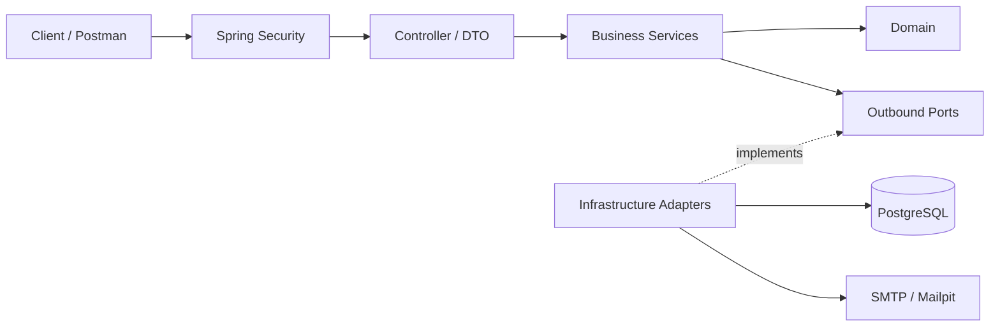

# Bus Booking System - Nền tảng đặt vé xe khách trực tuyến

## 1. Tổng quan đề tài

### 1.1. Bối cảnh

Hiện nay, nhu cầu di chuyển bằng xe khách rất phổ biến. Tuy nhiên, việc quản lý thông tin chuyến xe, lịch trình, số ghế còn trống và đặt vé vẫn có thể gặp nhiều bất tiện nếu được thực hiện thông qua các phương thức thủ công (phương thức truyền thống).

Về phía khách hàng, khó khăn trong việc tìm kiếm chuyến xe phù hợp và kiểm tra tình trạng ghế có thể mất nhiều thời gian, mất thời gian đi lại đến quầy để đặt vé.

Về phía nhà xe, việc quản lý chuyến xe, số lượng vé và thông tin hành khách cần đảm bảo tính chính xác, đặc biệt khi có nhiều yêu cầu đặt vé cùng lúc.

Vì vậy, hệ thống quản lý đặt vé xe khách trực tuyến được xây dựng nhằm cung cấp một nền tảng tập trung để người dùng tìm kiếm chuyến xe và thực hiện đặt vé, đồng thời hỗ trợ quản trị viên quản lý các dữ liệu cơ bản của hệ thống.

### 1.2. Vấn đề

Hệ thống tập trung giải quyết các vấn đề chính sau:

* Người dùng khó tìm kiếm và so sánh các chuyến xe phù hợp với nhu cầu di chuyển.
* Thông tin về tuyến đường, thời gian khởi hành, giá vé và số ghế còn trống cần được quản lý tập trung.
* Việc đặt vé thủ công gây khó khăn trong việc quản lý thông tin hành khách và số lượng vé.
* Số lượng ghế còn trống cần được cập nhật sau khi có booking.
* Người dùng cần có khả năng theo dõi các booking đã thực hiện.
* Quản trị viên cần có khả năng quản lý dữ liệu của hệ thống.

## 2. Chức năng và phạm vi pha 1

| Đối tượng | Chức năng chính |
|---|---|
| **Khách** | Tìm kiếm/xem chuyến xe, xem địa điểm, đăng ký và xác minh email bằng OTP |
| **USER** | Đăng nhập, cập nhật hồ sơ, đổi/đặt lại mật khẩu, giữ ghế và xác nhận đặt vé, xem lịch sử và hủy booking của mình |
| **ADMIN** | Quản lý nhà xe, phương tiện, địa điểm, tuyến đường, chuyến xe, tra cứu booking và đánh dấu đã hoàn tiền |
| **SUPER_ADMIN** | Có quyền của ADMIN và được nâng/hạ vai trò `USER` ↔ `ADMIN` |


## 3. Kiến trúc, công nghệ và tổ chức mã nguồn

BusBooking là **modular monolith**, kết hợp **Layered Architecture** với **Ports và Adapters**. Controller tiếp nhận HTTP; Business xử lý nghiệp vụ qua các interface (*ports*); adapter hiện thực truy cập dữ liệu, bảo mật và gửi email.



```text
src/main/java/com/example/busbooking/
├── api/           # Controllers, DTOs, mappers, validation
├── business/      # Services, commands, ports, results
├── domain/        # Models, enums, business exceptions
├── data/          # JPA entities, repositories, adapters, mappers
├── security/      # JWT, BCrypt, HMAC OTP, rate limiting
├── notification/  # SMTP email adapter
├── config/        # Cấu hình ứng dụng
└── exception/     # Chuẩn hóa lỗi HTTP
```

| Thành phần | Công nghệ và cách sử dụng |
|---|---|
| Backend | **Java 21, Spring Boot**, build/chạy bằng Maven Wrapper |
| Database | **PostgreSQL + Spring Data JPA**; **Flyway V1–V27** quản lý phiên bản schema (dữ liệu demo: danh mục và chuyến ở `db/catalogue`, dùng cho `dev` và Render; tài khoản và vé demo ở `db/seed`, chỉ `dev`) |
| Bảo mật | **Spring Security, JWT, BCrypt**, email OTP; phân quyền theo vai trò |
| Tích hợp | **SMTP** gửi OTP; **Mailpit** hỗ trợ kiểm tra email khi phát triển |
| API và kiểm thử | REST/JSON, Springdoc OpenAPI/Swagger, JUnit, Mockito, Locust |
| Môi trường | **Docker Compose** (`compose.yaml`: PostgreSQL, backend, frontend Nginx, Mailpit; `--profile metrics` thêm Prometheus/Grafana); overlay nhiều backend + Redis và HTTPS trong `deploy/`; Render Blueprint `render.yaml`; CI GitHub Actions |

## 4. Cấu hình và chạy nhanh (có thể xem chi tiết tại [Running Guide](docs-improvement/06-running-guide.md))

**Cần có:** JDK 21, PostgreSQL, SMTP (có thể dùng Mailpit) và source code chứa `pom.xml`, `mvnw.cmd`.

1. Chuẩn bị database PostgreSQL và SMTP; xác nhận địa chỉ/cổng đang sử dụng.
2. Cấu hình `DB_URL`, `DB_USERNAME`, `DB_PASSWORD`, ba secret độc lập `JWT_SECRET`, `EMAIL_OTP_SECRET`, `OTP_OUTBOX_SECRET` và các biến `SMTP_*`. Với Maven hoặc IDE, khai báo các biến trực tiếp trong phiên shell hoặc cấu hình chạy. [Running Guide](docs-improvement/06-running-guide.md)
3. Từ thư mục gốc repository, chạy:

   ```powershell
   $env:SPRING_PROFILES_ACTIVE = "dev"
   .\mvnw.cmd spring-boot:run '-Dspring-boot.run.jvmArguments=-Duser.timezone=Asia/Ho_Chi_Minh'
   ```

Khi kết nối database thành công, **Flyway kiểm tra/áp dụng các migration** khi ứng dụng khởi động. Với cấu hình local cổng `8085`, mở [Swagger UI](http://localhost:8085/swagger-ui/index.html) để thử API. Repository có `compose.yaml` (project `busbooking`) cho PostgreSQL, backend, frontend Nginx và Mailpit: sao chép `.env.docker.example` thành `.env`, điền secret, rồi chạy:

```powershell
docker compose up -d --build
```

Giao diện ở `http://localhost:5173`, backend publish `127.0.0.1:8086`, Mailpit `127.0.0.1:8026`. Profile `dev` có sẵn tài khoản demo `demo@busbooking.local` (USER) và `admin@busbooking.local` (ADMIN), mật khẩu `matkhau123`. Xem cổng, bootstrap và hạn chế SMTP của profile `dev` tại [Running Guide](docs-improvement/06-running-guide.md).

## 5. API và kiểm thử

- Tài liệu api đầy đủ: [thiết kế API](docs-improvement/04-api-design.md); Swagger cung cấp đặc tả tại `http://localhost:8085/v3/api-docs` khi backend chạy và docs được bật.
- **File api json:** [api json file](docs-improvement/openapi.json)

- **Kiểm thử tự động:** JUnit/Mockito và integration test; chạy `.\mvnw.cmd test` sau khi khởi động **database test riêng** (`busbooking_test` trên `127.0.0.1:55433`, biến `TEST_DB_*`) như Running Guide mục 6.7.
- **Load test Pha 1 (Kaggle CPU, Locust):** tại 20 người dùng ảo, snapshot CSV ghi GET **2.834 request / 48,01 RPS**, POST **2.789 / 47,21 RPS**; console cuối lượt ghi tương ứng **2.864 / 48,05 RPS** và **2.816 / 47,16 RPS**. Cả hai nguồn ghi 0 lỗi; nguyên nhân chênh lệch và mốc thống kê chuẩn **chưa xác minh**. Đây là *baseline thử nghiệm*, không phải giới hạn hiệu năng của hệ thống. Xem [kết quả kiểm thử tải](load-tests/README.md).

## 6. Tài liệu chi tiết và bàn giao Pha 2

| Tài liệu | Nội dung |
|---|---|
| [0 Những gì đã thay đổi](docs-improvement/00-what-changed.md) | Thay đổi so với upstream |
| [1 Tổng quan và yêu cầu hệ thống](docs-improvement/01-overview-and-requirements.md) | Yêu cầu, actors, nghiệp vụ |
| [2 Thiết kế database](docs-improvement/02-database-design.md) | ERD, ràng buộc, Flyway migrations |
| [3 Kiến trúc hệ thống (pha 1)](docs-improvement/03-system-architecture.md) | Thành phần, kiến trúc và hướng phụ thuộc |
| [4 Thiết kế API](docs-improvement/04-api-design.md) | Các API, phân quyền và hợp đồng |
| [5 Tổ chức mã nguồn](docs-improvement/05-source-code-design.md) | Tổ chức packages, services, ports và adapters |
| [6 Hướng dẫn chạy](docs-improvement/06-running-guide.md) | Cấu hình, khởi chạy, kiểm tra và xử lý lỗi |
| [7 Kế hoạch tối ưu Phase 2](docs-improvement/07-optimization-team-plan.md) | Kế hoạch ban đầu và phân công nhóm |
| [8 Kết quả Phase 2](docs-improvement/08-phase2-results.md) | Kết quả kiểm chứng Phase 2 |
| [9 Đối chiếu tiêu chuẩn](docs-improvement/09-standards-compliance.md) | Trạng thái so với các chuẩn được chọn |
| [Kết quả kiểm thử tải](load-tests/README.md) | Kết quả baseline Locust, CSV và console |
| [Hướng dẫn kiểm thử tải](load-tests/scripts/load_testing.md) | Hướng dẫn chạy Locust, tạo fixture và phân tích kết quả |

Bản tài liệu gốc của upstream được giữ nguyên, chỉ đọc, trong [`docs-upstream/`](docs-upstream/).

> **Lưu ý:** Không commit `.env`, mật khẩu, JWT/OTP secret hay dữ liệu cá nhân thật. Khi thay đổi database, tạo migration Flyway mới thay vì sửa migration đã áp dụng.

### Gợi ý cải tiến cho Pha 2

> Danh sách gợi ý ban đầu, giữ để đối chiếu. Phân trang tìm chuyến, `Idempotency-Key` cho booking, metric Prometheus/Grafana, rate limit dùng chung qua Redis, health check backend và CI đã được triển khai (xem [00](docs-improvement/00-what-changed.md), [08](docs-improvement/08-phase2-results.md)); cache Redis cho API đọc và mã liên kết request trong log chưa có.

- **PostgreSQL và tìm kiếm chuyến xe:** Truy vấn hiện trả về toàn bộ danh sách, còn một số index tăng tốc đã được hoãn ở V16; nên phân tích bằng `EXPLAIN ANALYZE` trên dữ liệu đại diện để chọn index phù hợp và bổ sung phân trang.
- **Booking đồng thời:** Pha 1 đã có transaction, khóa bi quan và cập nhật ghế có điều kiện; khi tải lớn, cần đo thời gian chờ khóa để tối ưu thời gian giữ khóa, timeout và connection pool. Cân nhắc cơ chế idempotency để tránh tạo booking lặp khi client gửi lại yêu cầu.
- **Redis Cache cho API đọc:** Các lượt đọc lặp lại có thể làm tăng tải PostgreSQL; cân nhắc cache địa điểm và kết quả tìm chuyến với TTL, cơ chế vô hiệu hóa khi dữ liệu thay đổi. Số ghế khi đặt vé vẫn phải được kiểm tra và cập nhật tại database trong transaction.
- **Monitoring và logging:** Bổ sung metric độ trễ API, lỗi, connection pool và thời gian chờ khóa để hỗ trợ phát hiện điểm nghẽn. Chuẩn hóa log có mã liên kết request và cảnh báo, đồng thời che thông tin nhạy cảm.
- **Mở rộng, Docker và CI/CD:** Trên nền Dockerfile/Compose hiện có, chuẩn hóa cấu hình triển khai, bổ sung health check cho backend và pipeline kiểm thử, build image, triển khai. Trước khi chạy nhiều backend instance, cần đưa bộ đếm rate limit đang lưu trong bộ nhớ sang cơ chế dùng chung.
- **Kiểm thử tải và bảo mật:** Mở rộng baseline Locust bằng dữ liệu lớn hơn, nhiều tài khoản, tải hỗn hợp đọc/ghi và tranh chấp trên cùng chuyến, kết hợp kiểm tra tính nhất quán ghế. Bổ sung kiểm thử bảo mật tự động và quét dependency để mở rộng độ bao phủ cho JWT, OTP, phân quyền và rate limit đã có.
