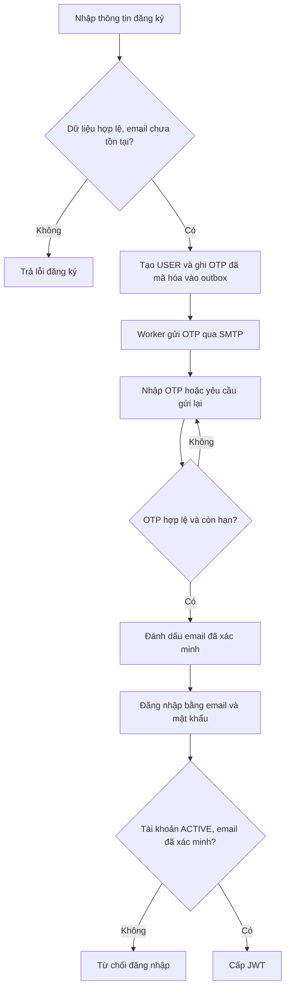
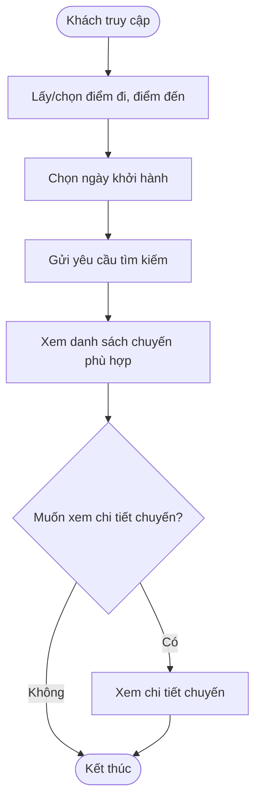
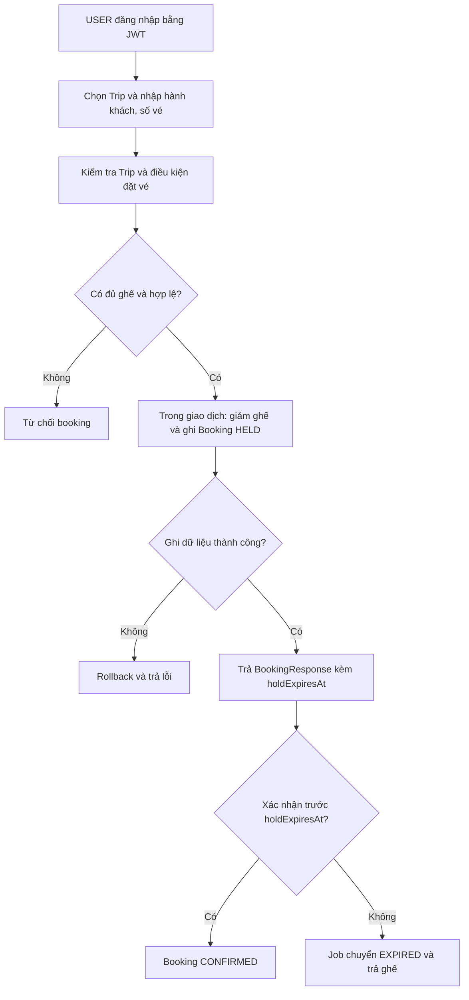
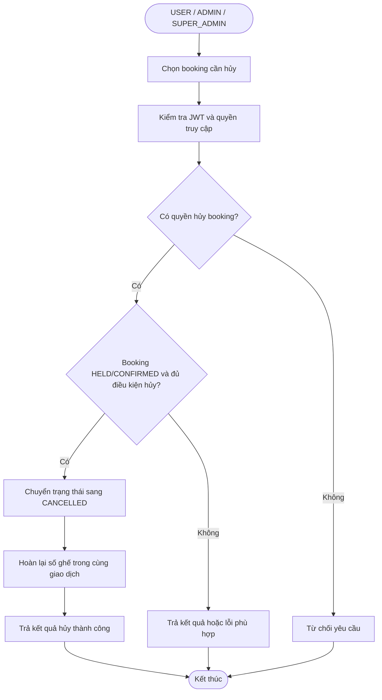
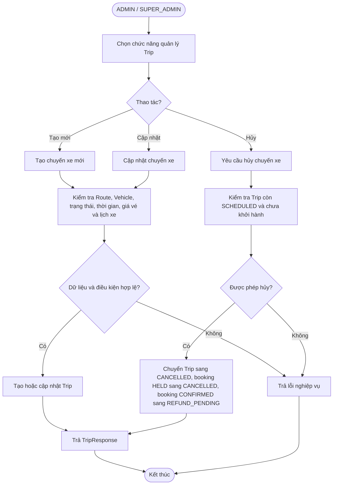

# 1. Tổng quan và yêu cầu hệ thống

## 1.1. Mục tiêu hệ thống

**BusBooking** là hệ thống backend phục vụ tra cứu chuyến xe khách và đặt vé qua REST API. Hệ thống hướng tới các mục tiêu:

- Cho phép người dùng đăng ký tài khoản, xác minh email bằng OTP, đăng nhập bằng JWT, đăng xuất, đổi mật khẩu và đặt lại mật khẩu qua mã gửi email.
- Cung cấp dữ liệu địa điểm, tìm kiếm chuyến xe theo điểm đi, điểm đến và ngày khởi hành; xem thông tin chuyến, giá vé và số ghế còn trống.
- Cho phép người dùng giữ chỗ, xác nhận booking trước khi hết hạn giữ chỗ, xem lịch sử/chi tiết đặt vé và hủy vé theo quy tắc nghiệp vụ.
- Cho phép quản trị viên quản lý nhà xe, địa điểm, phương tiện, tuyến đường, chuyến xe, tra cứu booking và ghi nhận hoàn tiền cho booking của chuyến bị hủy.
- Kiểm soát quyền truy cập theo vai trò, kiểm tra quyền sở hữu booking và duy trì tính nhất quán số ghế khi giữ chỗ/xác nhận/hủy vé.
- Cung cấp API dạng HTTP/JSON, có đặc tả OpenAPI để phục vụ kiểm thử, tích hợp và bàn giao cho nhóm Pha 2.

BusBooking Pha 1 tập trung vào **backend và nghiệp vụ cốt lõi**, chưa phải một nền tảng thương mại vận tải đầy đủ.

## 1.2. Phạm vi hệ thống

### 1.2.1. Trong phạm vi

- **Tài khoản và bảo mật:** đăng ký, xác minh/gửi lại OTP email, đăng nhập, đăng xuất (thu hồi mọi JWT đã cấp), quên/đặt lại mật khẩu bằng mã email, đổi mật khẩu, lấy thông tin người dùng, cập nhật hồ sơ, phân quyền `USER` / `ADMIN` / `SUPER_ADMIN`.
- **Tra cứu công khai:** lấy danh sách địa điểm, tìm kiếm chuyến xe và xem chi tiết chuyến xe.
- **Đặt vé:** tạo booking ở trạng thái giữ chỗ (`HELD`), xác nhận booking, xem booking của mình, xem chi tiết booking, hủy booking và hoàn ghế khi hủy hợp lệ; giữ chỗ quá hạn tự hết hạn và trả ghế.
- **Quản trị danh mục:** xem danh sách, tạo và cập nhật nhà xe, địa điểm, phương tiện, tuyến đường; kiểm soát trạng thái và ràng buộc liên quan.
- **Quản trị vận hành:** xem danh sách, tạo, cập nhật, hủy chuyến xe (đổi trạng thái, không xóa bản ghi), tra cứu booking toàn hệ thống và đánh dấu booking `REFUND_PENDING` là `REFUNDED` sau khi hoàn tiền ngoài hệ thống.
- **Quản lý vai trò:** chỉ `SUPER_ADMIN` được nâng/hạ vai trò giữa `USER` và `ADMIN` theo điều kiện hệ thống.
- **Tài liệu và kiểm thử:** Swagger/OpenAPI, kiểm thử chức năng và bộ baseline kiểm thử tải Pha 1.

### 1.2.2. Ngoài phạm vi

- Thanh toán trực tuyến, hoàn tiền tự động và đối soát thanh toán (hệ thống chỉ ghi nhận trạng thái hoàn tiền do quản trị viên thực hiện ngoài hệ thống).
- Chọn số ghế/vị trí ghế cụ thể trên sơ đồ xe; hệ thống hiện quản lý **số lượng ghế**.
- Hệ thống nhân viên (`STAFF`) hoặc tài khoản riêng cho nhân viên nhà xe.
- Ứng dụng mobile riêng; frontend hoàn chỉnh không phải phạm vi của backend này.
- Đánh giá nhà xe, khuyến mãi, trò chuyện và thông báo thời gian thực.
- Xóa vật lý dữ liệu nền tảng như nhà xe, phương tiện, địa điểm, tuyến đường đã có quan hệ nghiệp vụ.
- API liệt kê toàn bộ người dùng hoặc đổi trạng thái `ACTIVE/INACTIVE` của người dùng bằng chức năng Admin.
- Các cơ chế vận hành quy mô lớn như phân tán tải, message queue và auto-scaling.

## 1.3. Tác nhân (Actors)

| Actor | Phạm vi sử dụng |
|---|---|
| **Khách chưa đăng nhập (Guest)** | Xem địa điểm, tìm kiếm/xem chuyến xe, đăng ký, đăng nhập, xác minh hoặc gửi lại OTP, yêu cầu mã và đặt lại mật khẩu. Đây là trạng thái truy cập, không phải role lưu trong database. |
| **USER** | Các chức năng công khai; xem/cập nhật hồ sơ, đổi mật khẩu, đăng xuất, tạo và xác nhận booking, xem lịch sử/chi tiết và hủy booking của chính mình. |
| **ADMIN** | Các chức năng quản trị nhà xe, địa điểm, phương tiện, tuyến đường, chuyến xe, xem booking, thao tác booking trong phạm vi được phân quyền và đánh dấu đã hoàn tiền. Không có quyền thay đổi role. |
| **SUPER_ADMIN** | Có các quyền quản trị của `ADMIN` và quyền nâng/hạ `USER` ↔ `ADMIN` theo điều kiện hệ thống. |

**Lưu ý:** Hệ thống lưu ba vai trò `USER`, `ADMIN`, `SUPER_ADMIN`. Đăng ký công khai chỉ tạo tài khoản `USER`. Database chỉ cho phép tối đa **một** tài khoản `SUPER_ADMIN`; tài khoản này được khởi tạo qua cơ chế bootstrap có kiểm soát (chỉ chạy ở profile `dev`/`test`), không có endpoint công khai để tự cấp vai trò này.

## 1.4. Yêu cầu chức năng

Các mã **FR** mô tả khả năng nghiệp vụ, **không tương ứng một-một với số endpoint API**.

### 1.4.1. Tài khoản, xác thực và phân quyền

**FR-01 - Đăng ký tài khoản.** Người dùng cung cấp họ tên, email, số điện thoại và mật khẩu. Hệ thống kiểm tra dữ liệu hợp lệ và email không trùng; tài khoản mới có role `USER` và chưa xác minh email.

**FR-02 - Xác minh email bằng OTP.** Sau đăng ký, hệ thống gửi mã OTP qua email. Người dùng xác minh bằng email và mã OTP hợp lệ trước khi được đăng nhập. OTP không được trả về trong phản hồi API.

**FR-03 - Gửi lại OTP.** Người dùng chưa xác minh email có thể yêu cầu gửi mã mới. Yêu cầu vào hàng đợi và chịu giới hạn tần suất. Mã mới thay thế mã cũ sau khi SMTP chấp nhận email và worker ghi nhận phát thành công.

**FR-04 - Đăng nhập và cấp JWT.** Người dùng đăng nhập bằng email và mật khẩu. Chỉ tài khoản `ACTIVE`, đã xác minh email mới được cấp JWT để truy cập endpoint được bảo vệ. Số lần đăng nhập bị giới hạn theo địa chỉ IP và theo từng tài khoản; vượt giới hạn trả `429`.

**FR-05 - Đăng xuất.** Người dùng đã đăng nhập có thể đăng xuất; hệ thống tăng phiên bản token của tài khoản nên **mọi** JWT đã cấp trước đó cho tài khoản đều bị từ chối.

**FR-06 - Quên và đặt lại mật khẩu.** Người dùng yêu cầu mã đặt lại mật khẩu bằng email; phản hồi giống nhau dù email có tồn tại/đủ điều kiện hay không. Người dùng đặt mật khẩu mới bằng email, mã 6 chữ số và mật khẩu mới; khi thành công, mọi JWT cũ bị thu hồi.

**FR-07 - Xem/cập nhật hồ sơ.** Người dùng đã đăng nhập có thể xem thông tin tài khoản và cập nhật họ tên, số điện thoại của mình. Không được tự sửa role, trạng thái hoặc cờ xác minh email qua API hồ sơ.

**FR-08 - Đổi mật khẩu.** Người dùng đã đăng nhập đổi mật khẩu bằng mật khẩu hiện tại và mật khẩu mới (phải khác mật khẩu cũ). Thao tác chịu cùng hạn mức theo tài khoản như đăng nhập; khi thành công, mọi JWT đã cấp, kể cả token đang dùng, bị thu hồi.

**FR-09 - Kiểm soát truy cập.** Các endpoint yêu cầu đăng nhập phải kiểm tra JWT (gồm phiên bản token) và vai trò tương ứng. Các tài nguyên gắn với người dùng, đặc biệt booking, phải được kiểm tra quyền sở hữu ở tầng nghiệp vụ.

**FR-10 - Quản lý vai trò.** Chỉ `SUPER_ADMIN` có thể chuyển vai trò `USER` ↔ `ADMIN` theo các điều kiện hợp lệ; không cấp hoặc thay thế `SUPER_ADMIN` qua HTTP API.

### 1.4.2. Địa điểm và tra cứu chuyến xe

**FR-11 - Tra cứu địa điểm công khai.** Khách truy cập có thể lấy danh sách địa điểm và sử dụng điều kiện tìm kiếm được hỗ trợ để xác định điểm đi/điểm đến.

**FR-12 - Tìm kiếm chuyến xe.** Khách truy cập có thể lọc chuyến theo điểm đi, điểm đến và ngày khởi hành. Kết quả là danh sách phân trang gồm các chuyến `SCHEDULED`, còn ghế và chưa khởi hành.

**FR-13 - Xem chi tiết chuyến.** Hệ thống cung cấp thông tin chuyến, tuyến đường, nhà xe/phương tiện (theo dữ liệu phản hồi API), giờ khởi hành/đến, giá vé, số ghế còn trống và trạng thái.

### 1.4.3. Đặt vé và lịch sử booking

**FR-14 - Tạo booking (giữ chỗ).** `USER` đã xác thực có thể đặt số lượng vé hợp lệ cho một chuyến, cung cấp thông tin hành khách. Booking mới ở trạng thái `HELD`: ghế bị trừ ngay và được giữ đến `holdExpiresAt` (mặc định 10 phút). Hệ thống lưu giá tại thời điểm đặt, tổng tiền và mã booking. Header `Idempotency-Key` (tùy chọn) cho phép gửi lại yêu cầu an toàn.

**FR-15 - Kiểm tra khả năng đặt vé.** Hệ thống phải kiểm tra chuyến có đủ điều kiện phục vụ và đủ số ghế; từ chối khi số lượng yêu cầu vượt số ghế có thể bán. Thao tác đồng thời không được làm phát sinh tình trạng bán vượt sức chứa. Số yêu cầu đặt vé xử lý đồng thời trên mỗi instance (theo chuyến và tổng) bị giới hạn; vượt giới hạn trả `503` kèm `Retry-After`.

**FR-16 - Xác nhận booking.** Chủ booking (hoặc quản trị viên) xác nhận booking `HELD` trước `holdExpiresAt` để chuyển sang `CONFIRMED`; chuyến phải còn `SCHEDULED` và chưa khởi hành. Xác nhận lại booking đã `CONFIRMED` trả nguyên booking; giữ chỗ đã hết hạn trả `409 HOLD_EXPIRED`. Job nền định kỳ chuyển giữ chỗ quá hạn sang `EXPIRED` và trả ghế cho chuyến.

**FR-17 - Xem booking.** `USER` xem danh sách booking của mình và thông tin chi tiết booking được phép truy cập. `ADMIN`/`SUPER_ADMIN` được xem booking theo phạm vi quản trị.

**FR-18 - Hủy booking.** Booking `HELD` hoặc `CONFIRMED` có thể hủy. Chủ booking được hủy khi còn hơn 30 phút trước giờ đi. `ADMIN`/`SUPER_ADMIN` có thể hủy sau mốc này nhưng vẫn phải trước giờ đi và khi chuyến còn `SCHEDULED`. Hệ thống cập nhật trạng thái `CANCELLED` và hoàn ghế trong cùng transaction, với điều kiện số ghế hoàn nằm trong sức chứa.

### 1.4.4. Quản trị danh mục và vận hành

**FR-19 - Quản lý nhà xe.** `ADMIN`/`SUPER_ADMIN` xem danh sách, tạo, cập nhật nhà xe; có thể chuyển trạng thái khi đáp ứng điều kiện liên quan. Không hỗ trợ xóa vật lý trong Pha 1.

**FR-20 - Quản lý địa điểm.** `ADMIN`/`SUPER_ADMIN` xem danh sách, tạo và cập nhật địa điểm. Không có API xóa vật lý hoặc chuyển trạng thái địa điểm trong Pha 1.

**FR-21 - Quản lý phương tiện.** `ADMIN`/`SUPER_ADMIN` xem danh sách, tạo và cập nhật phương tiện, gồm nhà xe, biển số, loại xe, sức chứa và trạng thái; các thay đổi phải tôn trọng chuyến xe đang sử dụng phương tiện.

**FR-22 - Quản lý tuyến đường.** `ADMIN`/`SUPER_ADMIN` xem danh sách, tạo, cập nhật tuyến đường với điểm đi, điểm đến và thời gian dự kiến; không cho phép thay đổi trái quy tắc khi tuyến đã được chuyến xe tham chiếu.

**FR-23 - Quản lý chuyến xe.** `ADMIN`/`SUPER_ADMIN` xem danh sách, tạo và cập nhật chuyến xe; chỉ chuyến `SCHEDULED` chưa khởi hành mới được sửa hoặc hủy. Hủy chuyến thực hiện bằng chuyển trạng thái sang `CANCELLED`, **không xóa vật lý**: booking `HELD` của chuyến chuyển sang `CANCELLED`, booking `CONFIRMED` chuyển sang `REFUND_PENDING` và khách được gửi email thông báo. Job nền chuyển chuyến `SCHEDULED` sang `IN_PROGRESS` khi đến giờ đi và sang `COMPLETED` khi đến giờ đến.

**FR-24 - Tra cứu booking quản trị và ghi nhận hoàn tiền.** `ADMIN`/`SUPER_ADMIN` được xem danh sách booking toàn hệ thống và các bộ lọc được hỗ trợ (người dùng, chuyến, trạng thái). Thao tác xem/xác nhận/hủy booking cụ thể dùng các API Booking hiện có theo quyền truy cập. Endpoint Admin duy nhất thay đổi trạng thái booking là đánh dấu booking `REFUND_PENDING` thành `REFUNDED` sau khi đã hoàn tiền ngoài hệ thống.

## 1.5. Quy tắc nghiệp vụ (Business Rules)

| Mã | Quy tắc |
|---|---|
| **BR-01** | Email đăng ký phải hợp lệ, được chuẩn hóa và duy nhất. Mật khẩu không được lưu ở dạng văn bản thuần. |
| **BR-02** | Chỉ tài khoản `ACTIVE` và đã xác minh email mới được đăng nhập thành công. |
| **BR-03** | OTP xác minh email và mã đặt lại mật khẩu gồm 6 chữ số, có hiệu lực theo cấu hình hiện tại (10 phút), chỉ sử dụng một lần; tối đa 5 lần nhập sai cho một mã và gửi lại có thời gian chờ tối thiểu 60 giây. |
| **BR-04** | Các API được bảo vệ sử dụng JWT; `ADMIN` không được sử dụng API thay đổi vai trò; chỉ `SUPER_ADMIN` được nâng/hạ `USER` ↔ `ADMIN`. |
| **BR-05** | `USER` chỉ được xem, xác nhận và hủy booking thuộc về mình. Quyền của quản trị viên được xác định theo API và kiểm tra nghiệp vụ. |
| **BR-06** | Nhà xe, phương tiện, tuyến đường và chuyến phải tham chiếu dữ liệu hợp lệ; việc đổi trạng thái hoặc định danh có thể bị từ chối khi dữ liệu đang được sử dụng. |
| **BR-07** | Tuyến đường không được có điểm đi trùng điểm đến; cặp `(điểm đi, điểm đến)` có hướng phải tuân thủ ràng buộc duy nhất của hệ thống. |
| **BR-08** | Sức chứa phương tiện phải lớn hơn 0; chuyến xe có tuyến đường, phương tiện, thời gian và giá vé hợp lệ. |
| **BR-09** | Đặt vé cần chuyến `SCHEDULED`, giờ đi trong tương lai, số lượng vé dương và đủ ghế. |
| **BR-10** | Tạo booking và cập nhật số ghế phải nhất quán trong cùng giao dịch, kể cả khi có yêu cầu đồng thời. |
| **BR-11** | Booking lưu `unitPrice` và `totalAmount` tại thời điểm đặt, không tự động đổi theo giá Trip sau đó. |
| **BR-12** | Chủ booking chỉ được hủy trước giờ đi hơn 30 phút. Quản trị được bỏ qua mốc 30 phút nhưng không hủy được sau giờ đi. Hủy lặp booking đã `CANCELLED` trả lại booking đó, không hoàn ghế lần nữa. Booking `EXPIRED`, `REFUND_PENDING`, `REFUNDED` không hủy được. |
| **BR-13** | Hủy chuyến là chuyển trạng thái sang `CANCELLED`. Chuyến phải còn `SCHEDULED` và chưa khởi hành. Mọi booking `HELD` của chuyến chuyển sang `CANCELLED`; mọi booking `CONFIRMED` chuyển sang `REFUND_PENDING`, khách nhận email thông báo; admin hoàn tiền ngoài hệ thống rồi đánh dấu `REFUNDED`. |
| **BR-14** | Không xóa vật lý nhà xe, địa điểm, phương tiện và tuyến đường qua API quản trị Pha 1. |
| **BR-15** | Chức năng đăng ký công khai không cho phép tự chỉ định role `ADMIN` hay `SUPER_ADMIN`; API quản lý role không cấp `SUPER_ADMIN`. |
| **BR-16** | Trong 24 giờ, cùng tài khoản và cùng `Idempotency-Key` trả lại booking gốc nếu nội dung trùng, hoặc trả lỗi nếu nội dung thay đổi. |
| **BR-17** | Hai chuyến chưa hủy trên cùng xe không được chồng giờ. Chuyến có booking `HELD` hoặc `CONFIRMED` giữ tuyến và giờ đã bán; chỉ được đổi xe khi sức chứa xe mới không nhỏ hơn số ghế đã bán. |
| **BR-18** | Booking `HELD` phải được xác nhận trước `holdExpiresAt`; quá hạn, booking chuyển sang `EXPIRED` và ghế được trả lại cho chuyến. |
| **BR-19** | Đăng xuất, đặt lại mật khẩu và đổi mật khẩu thu hồi mọi JWT đã cấp cho tài khoản (JWT mang phiên bản token cũ bị từ chối). |
| **BR-20** | Mọi thời gian dạng giờ địa phương (giờ đi/đến, thời điểm đặt, hạn giữ chỗ) được lưu và hiển thị theo giờ Việt Nam (`Asia/Ho_Chi_Minh`). |

Xem giới hạn trường và mã HTTP trong [đặc tả API](04-api-design.md).

## 1.6. Luồng nghiệp vụ chính (Business Flows)

### BF-01 - Đăng ký, xác minh email và đăng nhập

Khi SMTP tạm lỗi, worker tiếp tục thử gửi yêu cầu trong outbox. Người dùng vẫn có thể yêu cầu mã khác theo quy tắc giới hạn tần suất.

### BF-02 - Tìm kiếm chuyến xe

### BF-03 - Tạo và xác nhận booking

Việc kiểm tra/cập nhật ghế phải xử lý được các yêu cầu đặt đồng thời; chỉ kiểm tra số ghế một lần trước khi lưu là chưa đủ để bảo đảm an toàn cạnh tranh.

### BF-04 - Hủy booking

### BF-05 - Quản trị chuyến xe

Sau khi hủy chuyến, worker gửi email thông báo cho từng booking `REFUND_PENDING`; quản trị viên hoàn tiền ngoài hệ thống rồi đánh dấu booking `REFUNDED`.

## 1.7. Yêu cầu chất lượng và giới hạn Pha 1

- **Bảo mật:** xác thực JWT, thu hồi token theo phiên bản token của tài khoản, phân quyền theo vai trò và kiểm tra ownership; OTP và mã đặt lại mật khẩu không được lưu/trả về dưới dạng văn bản thuần; các thao tác xác thực công khai có giới hạn tần suất theo IP, đăng nhập và đổi mật khẩu có thêm giới hạn theo tài khoản.
- **Toàn vẹn dữ liệu:** sử dụng khóa ngoại, ràng buộc database và giao dịch nghiệp vụ để tránh booking vượt ghế, hoàn ghế sai hoặc xếp một xe vào hai chuyến chồng giờ.
- **Dễ bảo trì:** source được tổ chức thành API, Business, Domain và các Adapter, phù hợp việc sửa đổi/kiểm thử từng phần.
- **Có thể triển khai:** ứng dụng Spring Boot dùng PostgreSQL, Flyway và được đóng gói để chạy trên môi trường hỗ trợ Docker; cách chạy xem [`06-running-guide.md`](06-running-guide.md).
- **Đo lường hiệu năng:** kết quả tải Pha 1 trên Kaggle CPU được lưu trong [`../load-tests/README.md`](../load-tests/README.md); đây là **baseline tham khảo**, không phải cam kết SLA hay công suất tối đa của hệ thống.
