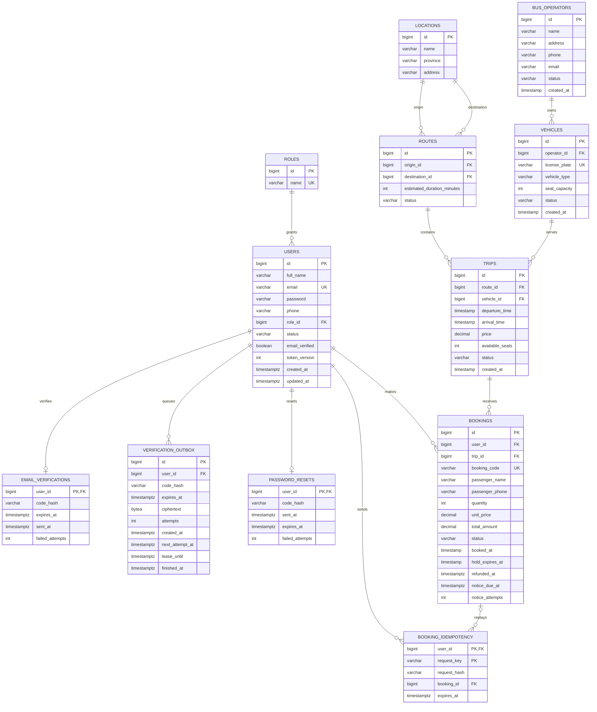

# 2. Thiết kế Database

## 2.1. Tổng quan

BusBooking sử dụng **PostgreSQL** để quản lý tài khoản, phân quyền, xác thực email, đặt lại mật khẩu, nhà xe, địa điểm, phương tiện, tuyến đường, chuyến xe và đặt vé. **Flyway** quản lý thay đổi schema thông qua các migration SQL trong source code.

Thiết kế tách các thực thể theo trách nhiệm để hạn chế trùng lặp dữ liệu; sử dụng khóa chính (PK), khóa ngoại (FK), ràng buộc duy nhất (UNIQUE), các điều kiện kiểm tra (CHECK) và một exclusion constraint. Cấu trúc chính có **12 bảng**:

| Bảng | Vai trò |
|---|---|
| `roles` | Các vai trò hệ thống: `USER`, `ADMIN`, `SUPER_ADMIN` |
| `users` | Tài khoản, quyền, trạng thái xác minh email và phiên bản token |
| `email_verifications` | Challenge OTP đang có hiệu lực; chỉ lưu mã băm/HMAC, không lưu OTP gốc |
| `verification_outbox` | Hàng đợi gửi email OTP; giữ OTP đã mã hóa đến khi gửi xong hoặc hết hạn |
| `password_resets` | Challenge đặt lại mật khẩu đang có hiệu lực; chỉ lưu mã băm/HMAC |
| `bus_operators` | Thông tin nhà xe |
| `locations` | Địa điểm đi/đến |
| `vehicles` | Phương tiện thuộc nhà xe |
| `routes` | Tuyến đường giữa hai địa điểm |
| `trips` | Lịch khởi hành cụ thể của một tuyến |
| `bookings` | Đơn đặt vé của người dùng, gồm giữ chỗ, hoàn tiền và thông báo hủy chuyến |
| `booking_idempotency` | Khóa `Idempotency-Key` của yêu cầu tạo booking, giữ 24 giờ |

> **Nguồn chính xác của schema:** Các file Flyway migration trong `src/main/resources/db/migration/`, được cấu hình bằng `spring.flyway.locations`. Source hiện có 27 migration liên tục V1–V27; V16 bỏ bốn index tăng tốc của V14/V15 và giữ các ràng buộc toàn vẹn. Profile `dev` nạp thêm `src/main/resources/db/seed/R__dev_seed_data.sql` (repeatable migration, dữ liệu demo); profile `test` và production không chạy file này. Trạng thái database đang chạy chưa được truy vấn để xác minh.

## 2.2. Sơ đồ quan hệ (ERD)



Quan hệ `USERS` – `EMAIL_VERIFICATIONS` và `USERS` – `PASSWORD_RESETS` là **1 – 0..1**: mỗi người dùng có nhiều nhất một challenge OTP và một challenge đặt lại mật khẩu đang được lưu. `booking_idempotency.booking_id` để trống trong lúc yêu cầu đang xử lý. Các quan hệ một–nhiều khác được thể hiện bằng khóa ngoại ở bảng phía nhiều. Các FK từ `email_verifications`, `verification_outbox`, `password_resets`, `booking_idempotency` dùng `ON DELETE CASCADE`.

## 2.3. Các bảng và trường chính

> **Quy ước thời gian (V27):** cột `TIMESTAMP` (không múi giờ) lưu **giờ Việt Nam** (`Asia/Ho_Chi_Minh`) theo đúng giá trị ứng dụng làm việc; cột `TIMESTAMPTZ` lưu thời điểm tuyệt đối. Mỗi kết nối của ứng dụng đặt `SET TIME ZONE 'Asia/Ho_Chi_Minh'`, và V27 đặt múi giờ mặc định của database thành `Asia/Ho_Chi_Minh` nếu tài khoản migration là chủ database.

### 2.3.1. Tài khoản và xác thực

**`roles`**

| Trường | Kiểu | Ý nghĩa |
|---|---|---|
| `id` | BIGINT | PK |
| `name` | VARCHAR(30) | Vai trò duy nhất: `USER`, `ADMIN`, `SUPER_ADMIN` |

**`users`**

| Trường | Kiểu | Ý nghĩa |
|---|---|---|
| `id` | BIGINT | PK |
| `full_name` | VARCHAR(100) | Họ tên |
| `email` | VARCHAR(100) | Email đăng nhập, duy nhất, lưu dạng chữ thường đã trim |
| `password` | VARCHAR(255) | Hash mật khẩu |
| `phone` | VARCHAR(20) | Số điện thoại |
| `role_id` | BIGINT | FK → `roles.id` |
| `status` | VARCHAR(20) | Trạng thái tài khoản: `ACTIVE`, `INACTIVE` (mặc định `ACTIVE`) |
| `email_verified` | BOOLEAN | `NOT NULL DEFAULT FALSE`, độc lập với `status` |
| `token_version` | INT | `NOT NULL DEFAULT 0`, `>= 0`; tăng khi đăng xuất, đặt lại hoặc đổi mật khẩu; JWT mang phiên bản cũ bị từ chối (V23) |
| `created_at`, `updated_at` | TIMESTAMPTZ | Mốc thời gian tạo/cập nhật; trigger `trg_users_updated_at` giữ nguyên `created_at` và cập nhật `updated_at` mỗi lần UPDATE |

**`email_verifications`**

| Trường | Kiểu | Ý nghĩa |
|---|---|---|
| `user_id` | BIGINT | PK, FK → `users.id`, `ON DELETE CASCADE` |
| `code_hash` | VARCHAR(64) | HMAC-SHA256 digest, không lưu OTP thô |
| `expires_at` | TIMESTAMPTZ | Hạn OTP |
| `sent_at` | TIMESTAMPTZ | Thời gian gửi |
| `failed_attempts` | INT | Số lần xác thực sai |

Khi xác minh thành công, challenge được xóa và `users.email_verified` được chuyển thành `TRUE` trong cùng giao dịch. Khi gửi lại OTP, challenge được thay mới.

**`verification_outbox`** (V19)

| Trường | Kiểu | Ý nghĩa |
|---|---|---|
| `id` | BIGINT | PK |
| `user_id` | BIGINT | FK → `users.id`, `ON DELETE CASCADE` |
| `code_hash` | VARCHAR(64) | HMAC của OTP, ghi vào `email_verifications` khi gửi thành công |
| `expires_at` | TIMESTAMPTZ | Hạn OTP; quá hạn thì không gửi nữa |
| `ciphertext` | BYTEA | OTP đã mã hóa; bị xóa (rỗng) khi hoàn tất |
| `attempts` | INT | Số lần đã thử gửi (`DEFAULT 0`) |
| `created_at` | TIMESTAMPTZ | Thời điểm tạo yêu cầu |
| `next_attempt_at` | TIMESTAMPTZ | Thời điểm sớm nhất được thử gửi |
| `lease_until` | TIMESTAMPTZ | Hạn giữ yêu cầu của worker đang gửi |
| `finished_at` | TIMESTAMPTZ | Thời điểm hoàn tất; `NULL` khi còn chờ |

**`password_resets`** (V24)

| Trường | Kiểu | Ý nghĩa |
|---|---|---|
| `user_id` | BIGINT | PK, FK → `users.id`, `ON DELETE CASCADE` |
| `code_hash` | VARCHAR(64) | HMAC-SHA256 digest của mã đặt lại, không lưu mã thô |
| `sent_at` | TIMESTAMPTZ | Thời gian gửi |
| `expires_at` | TIMESTAMPTZ | Hạn mã, phải sau `sent_at` |
| `failed_attempts` | INT | Số lần nhập sai (`DEFAULT 0`) |

Khi đặt lại mật khẩu thành công, mật khẩu mới được lưu, `users.token_version` tăng 1 và challenge bị xóa.

### 2.3.2. Nhà xe, địa điểm và phương tiện

**`bus_operators`**

| Trường | Kiểu | Ý nghĩa |
|---|---|---|
| `id` | BIGINT | PK |
| `name` | VARCHAR(150) | Tên nhà xe |
| `address` | VARCHAR(255) | Địa chỉ |
| `phone` | VARCHAR(20) | Điện thoại |
| `email` | VARCHAR(100) | Email liên hệ |
| `status` | VARCHAR(20) | Trạng thái: `ACTIVE`, `INACTIVE` |
| `created_at` | TIMESTAMP | Thời điểm tạo (giờ Việt Nam) |

**`locations`**

| Trường | Kiểu | Ý nghĩa |
|---|---|---|
| `id` | BIGINT | PK |
| `name` | VARCHAR(100) | Tên địa điểm |
| `province` | VARCHAR(100) | Tỉnh/thành phố |
| `address` | VARCHAR(255) | Địa chỉ |

**`vehicles`**

| Trường | Kiểu | Ý nghĩa |
|---|---|---|
| `id` | BIGINT | PK |
| `operator_id` | BIGINT | FK → `bus_operators.id` |
| `license_plate` | VARCHAR(20) | Biển số duy nhất |
| `vehicle_type` | VARCHAR(50) | Loại phương tiện |
| `seat_capacity` | INT | Sức chứa |
| `status` | VARCHAR(20) | Trạng thái: `ACTIVE`, `INACTIVE`, `MAINTENANCE` |
| `created_at` | TIMESTAMP | Thời điểm tạo (giờ Việt Nam) |

### 2.3.3. Tuyến, chuyến và đặt vé

**`routes`**

| Trường | Kiểu | Ý nghĩa |
|---|---|---|
| `id` | BIGINT | PK |
| `origin_id` | BIGINT | FK → `locations.id` |
| `destination_id` | BIGINT | FK → `locations.id` |
| `estimated_duration_minutes` | INT | Thời gian di chuyển dự kiến |
| `status` | VARCHAR(20) | Trạng thái tuyến: `ACTIVE`, `INACTIVE` |

**`trips`**

| Trường | Kiểu | Ý nghĩa |
|---|---|---|
| `id` | BIGINT | PK |
| `route_id` | BIGINT | FK → `routes.id` |
| `vehicle_id` | BIGINT | FK → `vehicles.id` |
| `departure_time`, `arrival_time` | TIMESTAMP | Thời gian đi/đến (giờ Việt Nam) |
| `price` | DECIMAL(12,2) | Giá vé hiện tại |
| `available_seats` | INT | Số ghế còn trống |
| `status` | VARCHAR(30) | Trạng thái chuyến: `SCHEDULED`, `IN_PROGRESS`, `COMPLETED`, `CANCELLED` |
| `created_at` | TIMESTAMP | Thời điểm tạo (giờ Việt Nam) |

`routes` thể hiện hành trình; `trips` thể hiện **một chuyến khởi hành cụ thể** trên hành trình đó.

**`bookings`**

| Trường | Kiểu | Ý nghĩa |
|---|---|---|
| `id` | BIGINT | PK |
| `user_id` | BIGINT | FK → `users.id` |
| `trip_id` | BIGINT | FK → `trips.id` |
| `booking_code` | VARCHAR(30) | Mã đặt vé duy nhất |
| `passenger_name` | VARCHAR(100) | Tên hành khách |
| `passenger_phone` | VARCHAR(20) | Số điện thoại hành khách |
| `quantity` | INT | Số vé |
| `unit_price` | DECIMAL(12,2) | Đơn giá tại thời điểm đặt |
| `total_amount` | DECIMAL(22,2) | Tổng tiền tại thời điểm đặt, mở rộng ở V21 |
| `status` | VARCHAR(30) | Trạng thái đặt vé: `HELD`, `CONFIRMED`, `EXPIRED`, `CANCELLED`, `REFUND_PENDING`, `REFUNDED` |
| `booked_at` | TIMESTAMP | Thời điểm đặt (giờ Việt Nam) |
| `hold_expires_at` | TIMESTAMP | Hạn giữ chỗ (giờ Việt Nam); bắt buộc khi `HELD`, đặt về `NULL` khi xác nhận, hết hạn hoặc hủy (V26) |
| `refunded_at` | TIMESTAMPTZ | Thời điểm admin đánh dấu `REFUNDED` (V25) |
| `notice_due_at` | TIMESTAMPTZ | Khác `NULL` khi email thông báo hủy chuyến còn phải gửi; đồng thời là thời điểm thử gửi tiếp theo (V25) |
| `notice_attempts` | INT | Số lần đã thử gửi email thông báo hủy chuyến, `DEFAULT 0` (V25) |

Giữ `unit_price` và `total_amount` trong booking để không làm thay đổi lịch sử thanh toán khi giá của chuyến thay đổi.

Vòng đời trạng thái booking: tạo mới là `HELD` (ghế đã trừ khỏi `trips.available_seats`) → `CONFIRMED` khi khách xác nhận trước `hold_expires_at`, hoặc `EXPIRED` khi job hết hạn giữ chỗ chạy (ghế được trả lại). `HELD`/`CONFIRMED` → `CANCELLED` khi hủy booking (ghế được trả lại). Khi hủy chuyến, `HELD` → `CANCELLED` và `CONFIRMED` → `REFUND_PENDING`; admin chuyển `REFUND_PENDING` → `REFUNDED` sau khi hoàn tiền ngoài hệ thống.

**`booking_idempotency`** (V17)

| Trường | Kiểu | Ý nghĩa |
|---|---|---|
| `user_id` | BIGINT | Một phần PK, FK → `users.id`, `ON DELETE CASCADE` |
| `request_key` | VARCHAR(128) | Giá trị header `Idempotency-Key`, một phần PK |
| `request_hash` | VARCHAR(64) | SHA-256 của nội dung yêu cầu (chuyến, hành khách, số vé) |
| `booking_id` | BIGINT | FK → `bookings.id`, `ON DELETE CASCADE`; `NULL` khi yêu cầu chưa hoàn tất |
| `expires_at` | TIMESTAMPTZ | Hạn của khóa (24 giờ sau khi tạo); job định kỳ xóa bản ghi hết hạn |

## 2.4. Ràng buộc toàn vẹn

| Nhóm | Quy tắc đáng chú ý |
|---|---|
| Khóa chính/ngoại | Liên kết đúng các bảng như ERD; `email_verifications.user_id` và `password_resets.user_id` đồng thời là PK và FK; `booking_idempotency` có PK ghép `(user_id, request_key)` |
| Duy nhất | `roles.name`, `users.email`, `vehicles.license_plate`, `bookings.booking_code` |
| Một SUPER_ADMIN | V11 tạo unique partial index `uk_users_single_super_admin` trên `users(role_id)` chỉ cho role `SUPER_ADMIN`, giới hạn tối đa một tài khoản thuộc vai trò này, kể cả tài khoản `INACTIVE` |
| Nhà xe (V13) | Tên/địa chỉ được chuẩn hóa khoảng trắng, email chữ thường, số điện thoại theo mẫu `^0([35789][0-9]{8}\|2[0-9]{9})$`; tên (không phân biệt hoa/thường) và email phải duy nhất |
| Địa điểm (V12) | Các trường được chuẩn hóa khoảng trắng; bộ ba `(name, province, address)` duy nhất theo so sánh không phân biệt hoa/thường |
| Tuyến (V14) | Cặp có hướng `(origin_id, destination_id)` không được trùng; tuyến ngược chiều là bản ghi khác |
| Phương tiện (V15) | Biển số chuẩn hóa thành uppercase, bỏ khoảng trắng và phải duy nhất; loại xe được chuẩn hóa khoảng trắng |
| Lịch xe (V18) | Exclusion constraint `trips_vehicle_schedule_no_overlap`: hai chuyến không `CANCELLED` trên cùng xe không được có khoảng `[departure_time, arrival_time)` chồng nhau |
| Giữ chỗ (V26) | `ck_bookings_hold_expiry`: booking `HELD` phải có `hold_expires_at` |
| Trạng thái | CHECK giới hạn giá trị `status` của `roles.name`, `users`, `bus_operators`, `vehicles`, `routes`, `trips`, `bookings` như mô tả ở mục 2.3 |
| Chuỗi không rỗng | Họ tên, mật khẩu, điện thoại người dùng; tên nhà xe; các trường địa điểm; biển số, loại xe; tên/điện thoại hành khách; `code_hash` của challenge |
| CHECK cơ bản | `seat_capacity > 0`, `estimated_duration_minutes > 0`, `price >= 0`, `available_seats >= 0`, `arrival_time > departure_time`, `quantity > 0`, `unit_price >= 0`, `total_amount >= 0`, `origin_id <> destination_id`, `token_version >= 0`, `failed_attempts >= 0` và `expires_at > sent_at` của `email_verifications`/`password_resets` |

Các quy tắc vượt phạm vi CHECK/FK do **tầng nghiệp vụ và transaction** xử lý, gồm: không bán vượt số ghế trống; không đặt vé cho chuyến không hợp lệ; hoàn ghế khi hủy booking hợp lệ hoặc khi giữ chỗ hết hạn; giới hạn thời gian và số lần nhập sai OTP/mã đặt lại mật khẩu; chỉ chủ sở hữu hoặc người có thẩm quyền được thao tác với booking.

## 2.5. Index và tra cứu

Các khóa `PRIMARY KEY`/`UNIQUE` tạo hoặc dựa trên index tương ứng trong PostgreSQL. Nhóm truy vấn đáng quan tâm khi đánh giá hiệu năng gồm:

| Truy vấn | Trường truy vấn liên quan |
|---|---|
| Đăng nhập | `users.email` |
| Tra cứu challenge | `email_verifications.user_id`, `password_resets.user_id` |
| Tìm tuyến | `routes.origin_id`, `routes.destination_id` |
| Tìm chuyến | `trips.route_id`, `trips.departure_time` |
| Lịch sử đặt vé | `bookings.user_id` |
| Danh sách booking của chuyến | `bookings.trip_id` |

V20 thêm hai partial index cho chuyến `SCHEDULED` còn ghế theo `(departure_time, id)` và `(route_id, departure_time, id)`. Index `bookings(user_id, booked_at DESC, id DESC)` hỗ trợ phân trang lịch sử cá nhân.

V22 thêm index `bookings(trip_id, status)` để quản trị tra cứu và đếm ghế đã bán theo chuyến. Hai partial index theo giờ đi của chuyến `SCHEDULED` và giờ đến của chuyến `IN_PROGRESS` hỗ trợ job chuyển trạng thái, kể cả khi chuyến đã hết ghế.

Các index phục vụ job nền: `idx_booking_idempotency_expiry` (V17) để xóa khóa hết hạn; `idx_verification_outbox_due` (partial, `finished_at IS NULL`) và `idx_verification_outbox_user_created` (V19) cho worker gửi OTP; `idx_bookings_notice_due` (partial, `notice_due_at IS NOT NULL`, V25) cho worker gửi email hủy chuyến; `idx_bookings_hold_expiry` (partial, `status = 'HELD'`, V26) cho job hết hạn giữ chỗ.

## 2.6. Migration Phase 2

| Phiên bản | Thay đổi |
|---|---|
| V17 | `booking_idempotency` giữ hash yêu cầu và ID booking theo cặp `(user_id, request_key)`. Bản ghi hết hạn sau 24 giờ. |
| V18 | Exclusion constraint GiST với `btree_gist` chặn hai khoảng giờ chồng nhau trên cùng xe. Khoảng giờ gồm thời điểm đi và loại thời điểm đến. Chuyến `CANCELLED` không tham gia ràng buộc. |
| V19 | `verification_outbox` giữ nội dung OTP đã mã hóa, số lần gửi và thời điểm có thể thử lại. Worker xóa nội dung mã hóa khi hoàn tất hoặc hết hạn. |
| V20 | Thêm index tìm chuyến còn ghế và phân trang lịch sử. |
| V21 | Mở rộng `bookings.total_amount` thành `NUMERIC(22,2)`. |
| V22 | Thêm index booking theo chuyến và partial index tìm chuyến tới mốc chuyển trạng thái. |
| V23 | Thêm `users.token_version` (`DEFAULT 0`, `>= 0`) để thu hồi JWT khi đăng xuất/đổi mật khẩu. |
| V24 | Tạo `password_resets`, cùng cấu trúc với `email_verifications`, cho chức năng quên/đặt lại mật khẩu. |
| V25 | Thêm trạng thái booking `REFUND_PENDING`, `REFUNDED` và các cột `refunded_at`, `notice_due_at`, `notice_attempts` cùng partial index `idx_bookings_notice_due` cho hoàn tiền khi hủy chuyến. |
| V26 | Thêm trạng thái booking `HELD`, `EXPIRED`, cột `hold_expires_at`, CHECK `ck_bookings_hold_expiry` và partial index `idx_bookings_hold_expiry` cho giữ chỗ trước khi xác nhận. |
| V27 | Cộng 7 giờ cho dữ liệu cũ của các cột `TIMESTAMP` (`trips.departure_time/arrival_time`, `bookings.booked_at/hold_expires_at`, `bus_operators.created_at`, `vehicles.created_at`) để chúng lưu giờ Việt Nam thay vì UTC; đặt múi giờ mặc định của database thành `Asia/Ho_Chi_Minh` (bỏ qua nếu không phải chủ database). |

Trước khi áp dụng V18 vào DB có dữ liệu cũ, kiểm tra lịch trùng bằng truy vấn dưới đây. Migration sẽ dừng với ID của một cặp chuyến xung đột nếu còn dữ liệu cần xử lý. Tài khoản migration cần quyền tạo extension `btree_gist` hoặc extension phải được quản trị DB cài trước.

```sql
SELECT a.vehicle_id, a.id AS first_trip, b.id AS second_trip
FROM trips a
JOIN trips b ON a.vehicle_id = b.vehicle_id AND a.id < b.id
WHERE a.status <> 'CANCELLED' AND b.status <> 'CANCELLED'
  AND a.departure_time < b.arrival_time
  AND b.departure_time < a.arrival_time;
```

Để đối soát ghế của chuyến sắp đi, kiểm tra `available_seats + SUM(quantity)` của các booking `HELD` và `CONFIRMED` bằng sức chứa hiện tại của xe.

```sql
SELECT t.id, t.available_seats,
       COALESCE(SUM(b.quantity), 0) AS taken_seats, v.seat_capacity
FROM trips t
JOIN vehicles v ON v.id = t.vehicle_id
LEFT JOIN bookings b ON b.trip_id = t.id AND b.status IN ('HELD', 'CONFIRMED')
WHERE t.status = 'SCHEDULED'
  AND t.departure_time > CURRENT_TIMESTAMP AT TIME ZONE 'Asia/Ho_Chi_Minh'
GROUP BY t.id, v.seat_capacity
HAVING t.available_seats + COALESCE(SUM(b.quantity), 0) <> v.seat_capacity;
```

## 2.7. Migration và vận hành schema

Schema được quản lý bởi **Flyway** khi ứng dụng khởi động, với 27 file V1–V27 trong source (V17–V27 xem mục 2.6). Các mốc thay đổi đáng chú ý đã đối chiếu migration là:

| Migration | Nội dung đối chiếu từ migration SQL |
|---|---|
| V1–V8 | Tạo `roles` (kèm dữ liệu `USER`, `ADMIN`), `users` (kèm trigger cập nhật `updated_at`), `bus_operators`, `locations`, `vehicles`, `routes`, `trips`, `bookings` |
| V9, V10 | V9 tạo `email_verifications`; V10 chỉ thêm `users.email_verified BOOLEAN NOT NULL DEFAULT FALSE` |
| V11 | Thêm vai trò `SUPER_ADMIN` và giới hạn tối đa một tài khoản giữ vai trò này |
| V12 | Chuẩn hóa và ràng buộc duy nhất dữ liệu địa điểm |
| V13 | Chuẩn hóa và kiểm soát trùng nhà xe |
| V14 | Ràng buộc duy nhất tuyến theo cặp điểm đi/đến có hướng |
| V15, V16 | V15 chuẩn hóa/kiểm soát biển số và thêm hai index tăng tốc; V16 bỏ bốn index tăng tốc của V14/V15, giữ toàn bộ ràng buộc toàn vẹn |

Không sửa nội dung migration đã áp dụng trên database đang sử dụng. Nếu cần thay đổi schema, tạo migration mới và kiểm tra tương thích với dữ liệu cũ.
