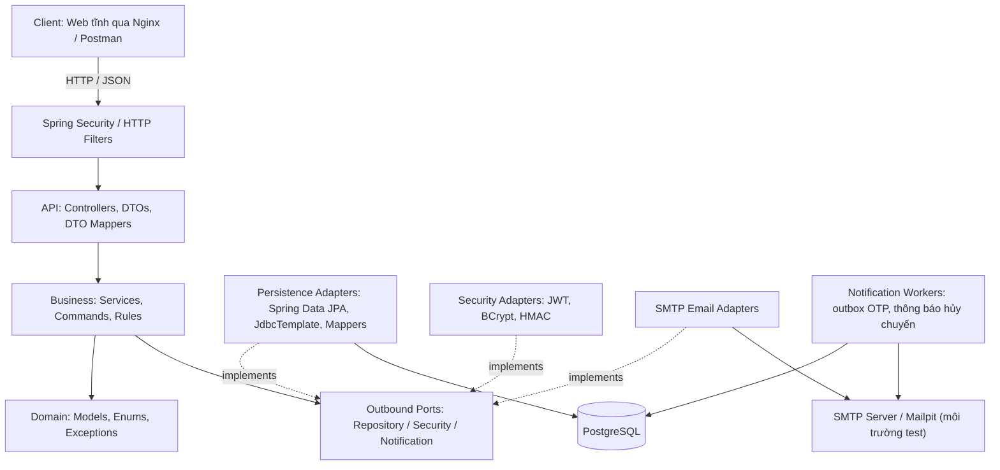
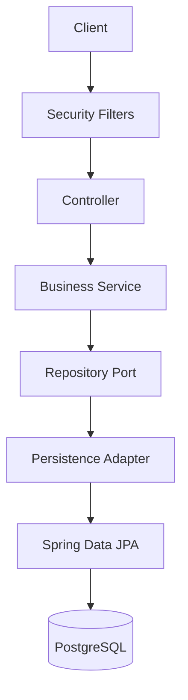
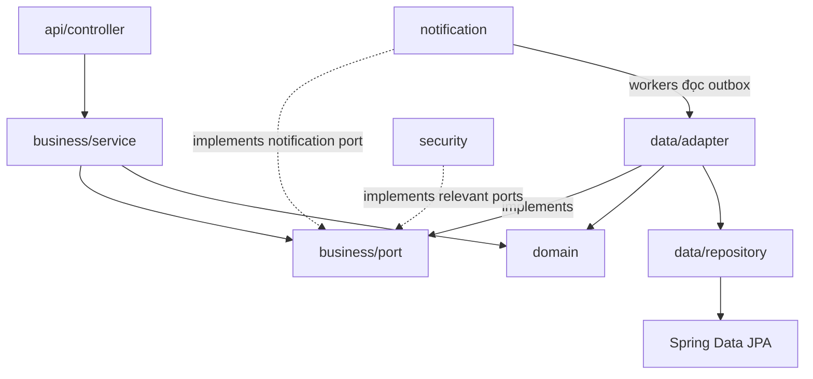
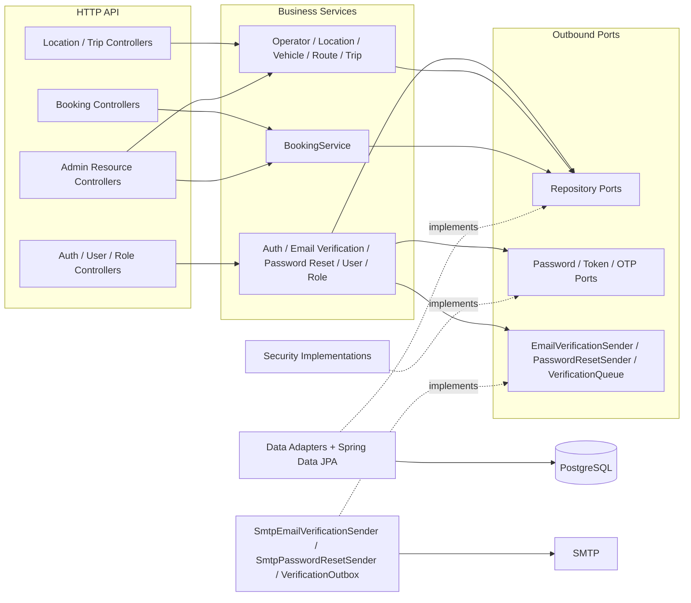
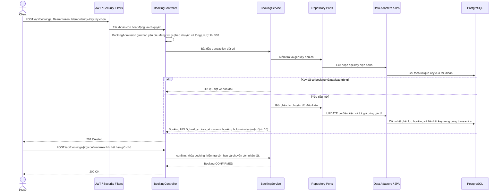
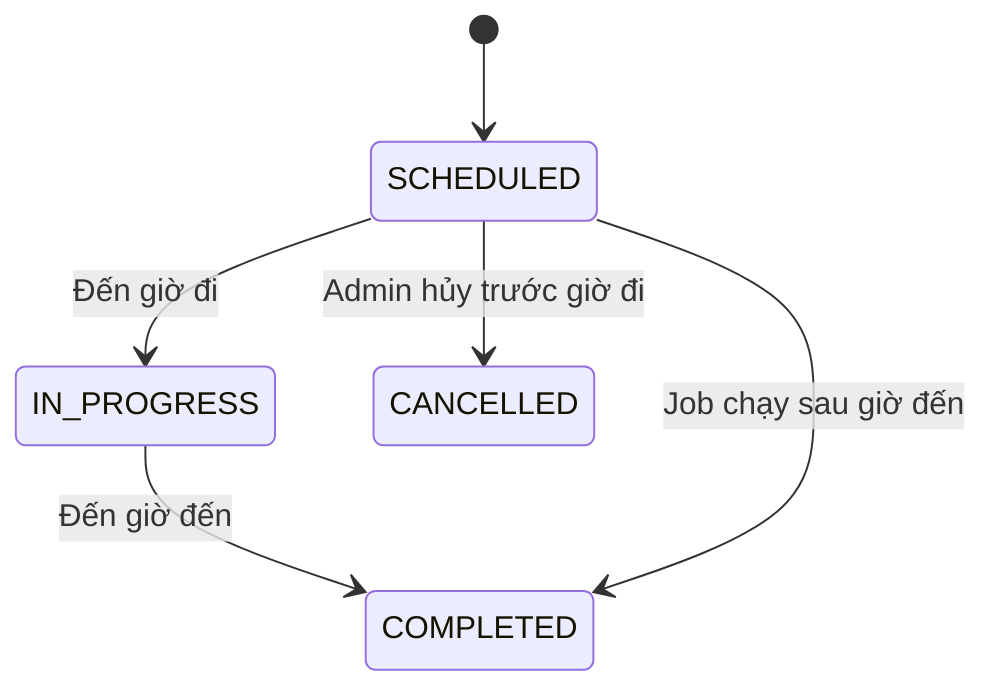
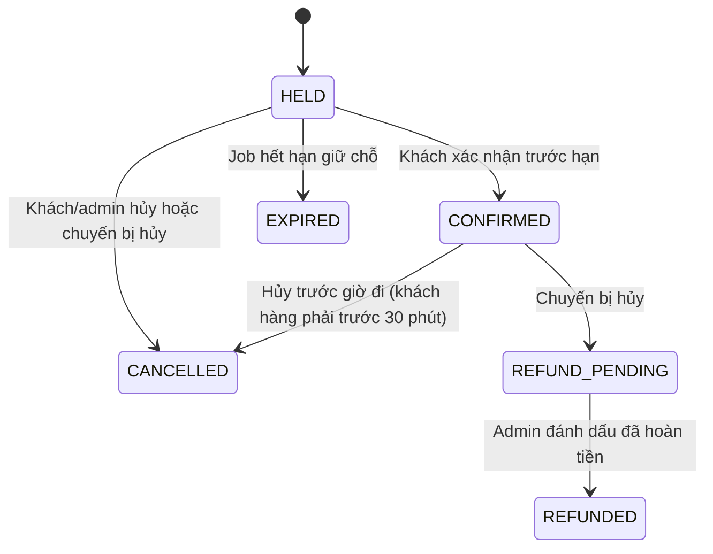
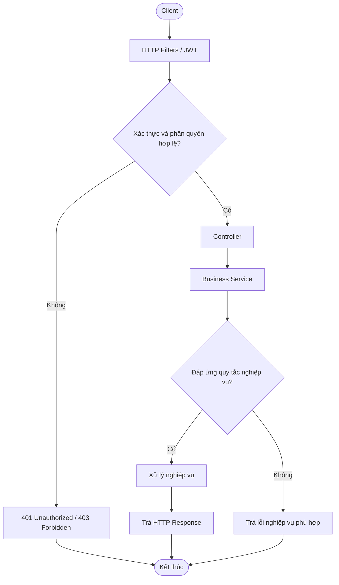
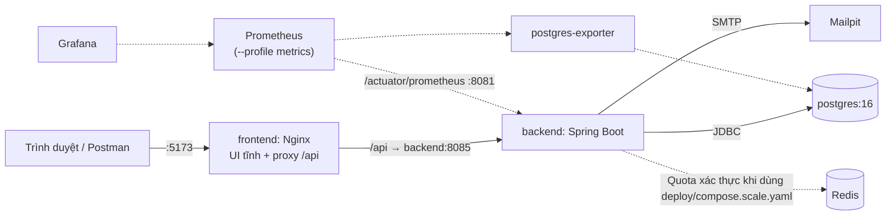

# 3. Kiến trúc hệ thống

## 3.1. Tổng quan

BusBooking là backend hỗ trợ quản lý tài khoản, xác thực email, danh mục nhà xe/địa điểm/phương tiện/tuyến đường, tìm kiếm chuyến xe và đặt vé. Ứng dụng được xây dựng bằng **Java 21, Spring Boot**, giao tiếp qua **REST/JSON**, lưu trữ trên **PostgreSQL** và quản lý thay đổi schema bằng **Flyway**.

Về tổ chức phần mềm, hệ thống kết hợp:

- **Kiến trúc phân lớp:** phân chia trách nhiệm thành các lớp tiếp nhận API, xử lý nghiệp vụ và truy cập dữ liệu.
- **Ports và Adapters:** nghiệp vụ khai báo các *port* (interface) để làm việc với repository, xác thực và gửi thông báo; các lớp hạ tầng cung cấp implementation tương ứng.

Đây là **một ứng dụng backend** được phân tách thành các package. Repo kèm một giao diện web tĩnh (`frontend/`: HTML/JS/CSS, không có bước build) do Nginx phục vụ và gọi API cùng origin qua `/api`; Postman hoặc client khác vẫn có thể gọi API trực tiếp.

**Lưu ý:** Sơ đồ trên thể hiện cả luồng tương tác và quan hệ triển khai interface. Các mũi tên `implements` **không** có nghĩa Business phụ thuộc vào lớp adapter. Nhánh JPA được minh họa; các adapter cho OTP, quản lý role, idempotency, outbox xác minh, đặt lại mật khẩu và thông báo hủy chuyến còn dùng `JdbcTemplate` trực tiếp.

## 3.2. Các thành phần và trách nhiệm

| Thành phần | Package chính | Vai trò |
|---|---|---|
| API | `api/controller`, `api/dto`, `api/mapper`, `api/validation` | Nhận request, xác thực dữ liệu ở ranh giới HTTP, ánh xạ DTO và trả response |
| Business | `business/service`, `business/command`, `business/result` | Điều phối use case, kiểm tra quy tắc nghiệp vụ, tạo kết quả độc lập với định dạng HTTP |
| Outbound Ports | `business/port/repository`, `business/port/security`, `business/port/notification` | Định nghĩa các hợp đồng cần dùng từ hạ tầng |
| Domain | `domain/model`, `domain/enums`, `domain/exception` | Mô hình nghiệp vụ, trạng thái và ngoại lệ nghiệp vụ |
| Persistence | `data/adapter`, `data/repository`, `data/entity`, `data/mapper` | Hiện thực repository port bằng JPA/mapping domain ↔ entity; OTP, quản lý role, idempotency, outbox xác minh, đặt lại mật khẩu và hàng đợi thông báo hủy chuyến (`TripCancellationNotices`) dùng `JdbcTemplate` |
| Security | `security`, `security/ratelimit` | Xác thực JWT (HS256, claim `ver`), mã hóa mật khẩu, HMAC OTP, mã hóa AES-GCM nội dung outbox, giới hạn tần suất, audit đổi role và xử lý lỗi truy cập |
| Notification | `notification` | Adapter SMTP gửi email xác minh và mã đặt lại mật khẩu; worker gửi outbox xác minh và thông báo hủy chuyến |
| Cross-cutting | `config`, `exception` | Cấu hình ứng dụng, OpenAPI, `Clock`, biểu diễn lỗi HTTP và xử lý exception tập trung |
| Persistence schema | `src/main/resources/db/migration` | Các migration Flyway V1–V27 cho PostgreSQL |

### API layer

Các controller hiện có được tổ chức theo nhóm nghiệp vụ:

- **Tài khoản/quyền:** `AuthController`, `UserController`, `RoleManagementController`.
- **Đọc dữ liệu công khai hoặc theo quyền:** `LocationController`, `TripController`, `BookingController`.
- **Quản trị:** `AdminBookingController`, `AdminLocationController`, `AdminOperatorController`, `AdminRouteController`, `AdminTripController`, `AdminVehicleController`.

`api/controller` còn có `BookingAdmission`: giới hạn số yêu cầu đặt vé đang xử lý trên mỗi instance, theo từng chuyến (`booking.max-in-flight-per-trip`) và tổng cộng (`booking.max-in-flight-total`, mặc định 8), để các chuyến đông khách không chiếm hết connection pool; vượt giới hạn trả `503`.

Mỗi controller làm việc với DTO của `api/dto` và mapper của `api/mapper`. **Không có** một `AdminController` chung trong cây source hiện tại; chức năng quản trị được tách theo tài nguyên. Mô tả đường dẫn/HTTP method chi tiết thuộc `04-api-design.md` và file OpenAPI xuất từ ứng dụng.

### Business và Domain

Các service hiện diện trong `business/service` gồm `AuthService`, `EmailVerificationService`, `PasswordResetService`, `UserService`, `RoleManagementService`, `BootstrapSuperAdminService`, `OperatorService`, `LocationService`, `VehicleService`, `RouteService`, `TripService`, `BookingService`, cùng các chính sách đầu vào như `AuthInputPolicy` và `OperatorInputPolicy`, và tiện ích giờ Việt Nam `TravelTime`.

- **Business service** thực hiện luồng use case, phối hợp các port và áp dụng điều kiện nghiệp vụ.
- **Domain model / enum** biểu diễn `User`, `Operator`, `Vehicle`, `Route`, `Trip`, `Booking` cùng các trạng thái liên quan.
- **Domain exception** biểu diễn các tình huống nghiệp vụ, ví dụ `InsufficientSeatsException`, `TripConflictException`, `ForbiddenOperationException`, `DuplicateRouteException`.

Những quy tắc như quyền sở hữu booking, số ghế khả dụng hoặc trạng thái chuyến không nên được viết lặp lại trong controller hay repository adapter.

## 3.3. Quy tắc phụ thuộc (Dependency Rule)

Cần phân biệt **luồng gọi lúc chạy** và **phụ thuộc khi biên dịch**:

**Luồng gọi khi xử lý HTTP:** Sơ đồ minh họa nhánh Spring Data JPA; các adapter OTP, role, giữ ghế, idempotency, outbox và đặt lại mật khẩu có nhánh JDBC trực tiếp tới PostgreSQL.

**Phụ thuộc ở mã nguồn:**

Ví dụ có thể đối chiếu trong source:

| Vai trò | Class/interface |
|---|---|
| Repository port | `business/port/repository/BookingRepository.java` |
| Implementation | `data/adapter/BookingRepositoryAdapter.java` |
| Truy cập JPA | `data/repository/SpringDataBookingRepository.java` |
| Persistence entity | `data/entity/BookingEntity.java` |
| Mapping | `data/mapper/BookingPersistenceMapper.java` |

`BookingService` sử dụng hợp đồng repository của tầng nghiệp vụ thay vì cần biết trực tiếp cơ chế JPA hoặc PostgreSQL. Cách tách này giúp thay implementation lưu trữ và viết kiểm thử bằng fake/mock repository dễ hơn. Việc tất cả class đều tuân thủ quy tắc này cần được kiểm tra bằng import/dependency thực tế, không thể kết luận chỉ từ cấu trúc thư mục.

## 3.4. Các thành phần chức năng

Sơ đồ nhóm các controller/service để dễ nhìn, **không biểu diễn đầy đủ mọi lời gọi giữa từng class**. `VerificationQueue` được hiện thực bởi `data/adapter/VerificationOutbox` (ghi vào bảng outbox), còn hai sender SMTP nằm ở `notification`. `TripService.cancel` chỉ ghi trạng thái booking; email báo hủy chuyến do `TripCancellationNoticeWorker` gửi sau, không đi qua port. Ví dụ một Admin Controller có thể dùng service nghiệp vụ tương ứng; không có `AdminService` tổng hợp.

## 3.5. Luồng xử lý nghiệp vụ điển hình

### Đặt vé: `POST /api/bookings`

Booking mới ở trạng thái `HELD` và giữ ghế cho tới khi khách xác nhận (`HELD → CONFIRMED`). Job `BookingService.expireHolds` (mặc định 15 giây/lần, `booking.hold-expiry-interval-ms`) chuyển các hold quá hạn sang `EXPIRED` và trả ghế cho chuyến trong một câu lệnh; job này an toàn khi chạy song song trên mọi instance. Xác nhận một hold đã quá hạn trả lỗi `HoldExpiredException` ngay cả khi job chưa chạy. Key idempotency hết hạn được dọn bởi job chạy mỗi 60 giây.

Các thay đổi ghế, booking và liên kết idempotency nằm trong một transaction. Tạo booking dùng `UPDATE … RETURNING` để giữ ghế và đọc giá. Service đối chiếu lại giờ đi sau khi câu lệnh lấy được khóa. Khi không giữ được ghế, service đọc hàng dưới khóa để phân biệt chuyến thiếu, chuyến hết ghế và chuyến không còn nhận đặt, hoặc thử giữ lại nếu ghế vừa được hoàn. Hủy booking khóa booking rồi khóa chuyến, sau đó kiểm tra sức chứa và hoàn ghế trong cùng transaction. Giới hạn đồng thời theo chuyến hoạt động trên từng instance, còn PostgreSQL vẫn quyết định số ghế có thể bán.

### Đăng ký và xác thực email

1. `AuthController` gọi `AuthService` và `EmailVerificationService`. Adapter của `VerificationQueue` lưu tài khoản và nội dung OTP đã mã hóa trong cùng transaction, rồi API trả `201`.
2. `VerificationOutboxWorker` nhận quyền xử lý một mục tới hạn qua `SKIP LOCKED` và lease, rồi gọi SMTP ngoài transaction.
3. Nếu gửi thành công, worker lưu HMAC digest của mã mới và xóa nội dung mã hóa khỏi outbox. Nếu gửi lỗi, worker đặt lịch gửi lại và giữ nguyên mã đã gửi trước đó. SMTP có thể nhận cùng email lần nữa khi tiến trình dừng sau khi gửi nhưng trước khi ghi nhận hoàn tất.
4. Người dùng xác minh OTP rồi đăng nhập để nhận JWT. Filter dùng projection ID, email, role và `token_version` của tài khoản còn hoạt động, đã xác minh để xác thực các request sau đó.

### Quên và đặt lại mật khẩu

`POST /api/auth/forgot-password` gọi `PasswordResetService`: lưu HMAC digest của mã 6 số qua `PasswordResetRepository` (có thời gian chờ giữa hai lần gửi), rồi gửi mã **đồng bộ** qua `SmtpPasswordResetSender` sau khi commit, không qua outbox. Email không tồn tại, chưa xác minh hoặc bị khóa nhận cùng phản hồi. `POST /api/auth/reset-password` kiểm tra mã (giới hạn số lần thử), ghi hash mật khẩu mới và tăng `users.token_version` để thu hồi mọi JWT cũ.

### Vòng đời chuyến

`TripService.advanceTripLifecycle` chạy định kỳ (mặc định 30 giây, `booking.lifecycle.interval-ms`) và chuyển trạng thái bằng một câu `UPDATE` so với giờ Việt Nam hiện tại.

Khi admin hủy chuyến (`TripService.cancel`), trong cùng transaction: các booking `HELD` bị hủy, các booking `CONFIRMED` chuyển sang `REFUND_PENDING` kèm thời điểm cần gửi thông báo, và ghế được trả lại chuyến. `TripCancellationNoticeWorker` nhận từng thông báo tới hạn qua `TripCancellationNotices` (`SKIP LOCKED` và lease) rồi gửi email cho khách; gửi lỗi thì thông báo tới hạn lại khi hết lease. Sau khi hoàn tiền ngoài hệ thống, admin gọi `POST /api/admin/bookings/{id}/refund` để chuyển booking sang `REFUNDED` (V25).

Cây source có `BootstrapSuperAdminService` và `RoleManagementService`; chi tiết điều kiện tạo SUPER_ADMIN, nâng/hạ quyền và quy tắc xác minh email cần tham chiếu API/kiểm thử hiện hành, thay vì suy ra chỉ từ tên class.

## 3.6. Bảo mật và xử lý lỗi

### Authentication & Authorization

- `SecurityConfig` tổ chức các thành phần Spring Security và quy tắc truy cập HTTP.
- `JwtAuthenticationFilter`, `JwtService` và `CurrentUserLoader` tham gia xử lý request có Bearer token. JWT ký HS256 (chỉ chấp nhận HS256) và mang claim `ver`; `CurrentUserLoader` từ chối token khi `ver` khác `users.token_version` (V23). Đăng xuất, đổi mật khẩu và đặt lại mật khẩu tăng `token_version`, nên mọi token cũ bị thu hồi ngay.
- `BCryptPasswordHasher`, `HmacVerificationCodeProvider` tương ứng với mật khẩu và mã OTP; `VerificationPayloadCipher` mã hóa AES-GCM mã OTP nằm chờ trong outbox.
- `AuthRateLimitFilter` giới hạn theo IP và endpoint cho register, login, verify-email, resend-verification, forgot-password và reset-password; `AuthController` giới hạn thêm số lần đăng nhập theo tài khoản (khóa là SHA-256 của email), vì giới hạn theo IP không chặn được dò một tài khoản từ nhiều địa chỉ. Filter dùng địa chỉ client do Tomcat xác định. Compose cấu hình chỉ tin IP của Nginx, và Nginx ghi lại địa chỉ client từ kết nối. Bộ giới hạn local (`AuthRequestRateLimiter`) dùng bộ nhớ; chế độ Redis (`RedisAuthRateLimiter`, `AUTH_RATE_LIMIT_BACKEND=redis`) dùng chung quota trên các instance.
- Role nghiệp vụ được biểu diễn bằng `RoleName`; code hiện có các thành phần quản lý role/SUPER_ADMIN. Quyền truy cập cụ thể phải lấy từ `SecurityConfig` và service tương ứng.
- **Audit log:** logger `security.audit` ghi đăng nhập thành công/thất bại/bị chặn, đăng xuất, đổi và đặt lại mật khẩu (email chỉ ghi dưới dạng mã băm rút gọn); `RoleChangeAudit` ghi sự kiện `RoleChanged` sau khi transaction đổi role commit.

### Exception handling

- `domain/exception`: mô tả lỗi nghiệp vụ, không gắn trực tiếp với JSON HTTP.
- `exception/GlobalExceptionHandler`, `ErrorResponse`, `ApiErrorWriter`: hỗ trợ chuyển lỗi sang phản hồi API.
- `JsonAuthenticationEntryPoint`, `JsonAccessDeniedHandler` và `ApiExceptionBoundaryFilter`: xử lý một số trường hợp lỗi tại ranh giới Security/filter.

Việc ánh xạ lỗi sang HTTP 400/401/403/404/409 phải căn cứ vào handler thực tế và đặc tả OpenAPI; không nên cố định mã lỗi chỉ từ tên exception.

## 3.7. Kiến trúc dữ liệu và triển khai

### Database

Ứng dụng dùng PostgreSQL qua Spring Data JPA và JdbcTemplate. Các adapter dùng JDBC cho giữ ghế, idempotency, outbox, xác minh email, đặt lại mật khẩu, thông báo hủy chuyến và quản lý role; hết hạn hold, hoàn tiền khi hủy chuyến và vòng đời chuyến dùng native query của Spring Data. Flyway quản lý schema qua V1–V27.

**Giờ Việt Nam:** các cột `TIMESTAMP` không múi giờ (giờ đi/đến, `booked_at`, `hold_expires_at`…) lưu giờ Việt Nam (V27). Bean `Clock` là UTC; `business/service/TravelTime` quy đổi sang `Asia/Ho_Chi_Minh` cho mọi so sánh nghiệp vụ và định dạng giờ trong email. Mỗi connection Hikari chạy `SET TIME ZONE 'Asia/Ho_Chi_Minh'`, và container đặt `TZ`/`-Duser.timezone` cùng múi giờ.

Tài liệu thiết kế bảng, khóa ngoại, constraint và index: [`02-database-design.md`](02-database-design.md).

### Môi trường chạy

Docker Compose cục bộ (`compose.yaml` ở thư mục gốc, project `busbooking`):

- **`compose.yaml`:** `postgres` (chỉ mở `127.0.0.1:5435`), `backend` (API `127.0.0.1:8086`, Actuator `127.0.0.1:8087`), `frontend` Nginx trên cổng `5173`, `mailpit` (hộp thư `127.0.0.1:8026`). `--profile metrics` thêm Prometheus (`127.0.0.1:9090`), Grafana (`127.0.0.1:3000`, dashboard "BusBooking") và postgres-exporter; cấu hình nằm ở `deploy/observability/`.
- **Nginx (`deploy/nginx/`):** `nginx-app.conf` phục vụ UI tĩnh, proxy `/api/` tới `backend:8085` cùng origin (không cần CORS) và thêm security header (CSP, `X-Content-Type-Options`, `Referrer-Policy`); `nginx.conf` là server HTTP, `nginx-tls.conf` là server HTTPS.
- **Overlay:** `deploy/compose.scale.yaml` chạy nhiều backend (`--scale backend=N`) sau Nginx và chuyển giới hạn tần suất xác thực sang Redis dùng chung; `deploy/compose.tls.yaml` bật HTTPS tại Nginx (80 chuyển hướng sang 443, có HSTS) với chứng chỉ trong `deploy/certs/`.
- **Actuator:** chạy trên cổng quản trị riêng `8081`, mặc định chỉ lắng nghe loopback (`management.server.address=127.0.0.1`); Compose mở trong container để healthcheck/Prometheus dùng nhưng chỉ publish ra loopback của host. Endpoint mở: `health`, `metrics`, `prometheus`.
- **Dockerfile:** build Maven nhiều stage, image chạy bằng user không phải root, `TZ=Asia/Ho_Chi_Minh`, heap theo `MaxRAMPercentage=75`.
- **Render (`render.yaml`):** backend Docker gói free (`busbooking-api`, health check `/api/trips` vì Actuator chỉ ở loopback) và frontend tĩnh (`busbooking-web`) rewrite `/api/*` sang backend; database ở Neon (ngoài Render); email qua Brevo SMTP cổng `2525` vì Render free chặn 25/465/587.
- **Kaggle CPU:** bài kiểm thử tải Pha 1 chạy Java, PostgreSQL và Locust trong notebook, **không phải sơ đồ triển khai Docker production**. Xem [`../load-tests/README.md`](../load-tests/README.md) để biết baseline.

