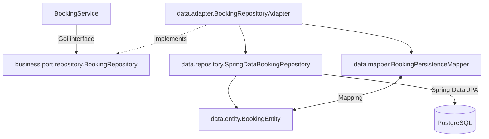
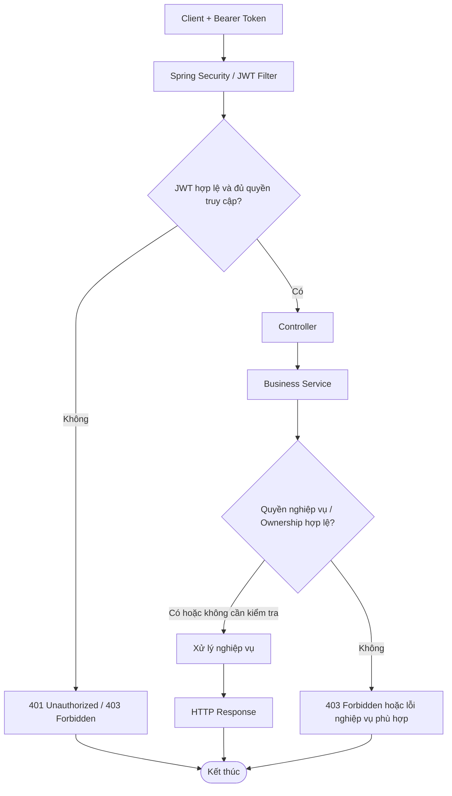
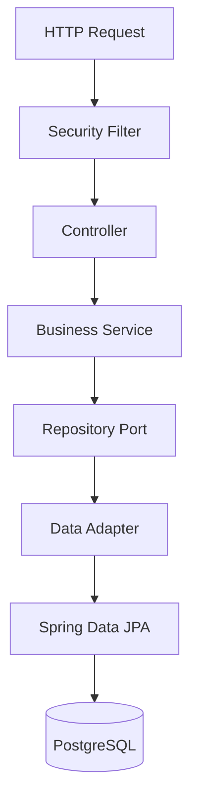
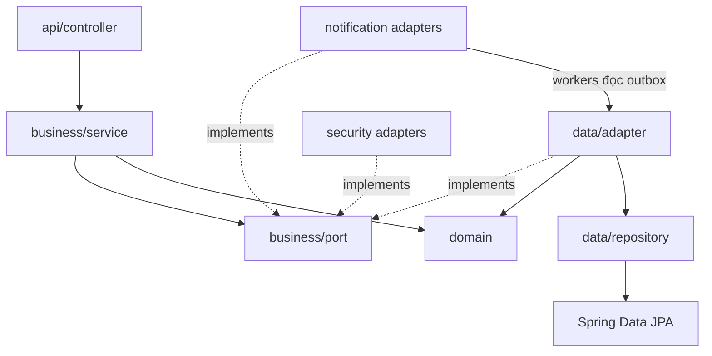

# 5. Tổ chức mã nguồn

## 5.1. Tổng quan

BusBooking là một ứng dụng backend Java 21/Spring Boot cung cấp REST API với dữ liệu PostgreSQL. Mã nguồn áp dụng **Kiến trúc phân lớp kết hợp Ports và Adapters**: tầng API tiếp nhận HTTP; tầng Business triển khai use case; tầng Domain định nghĩa khái niệm nghiệp vụ; adapter hạ tầng đảm nhiệm lưu trữ, bảo mật và gửi email.

Ứng dụng hiện tổ chức thành **một backend duy nhất với các package nghiệp vụ**, không phải hệ thống microservices. Các thành phần nổi bật gồm:

- **REST API:** controller, DTO, mapper và validation đầu vào.
- **Business:** service, command/result và các port (interface).
- **Domain:** model, enum trạng thái và exception nghiệp vụ.
- **Persistence:** JPA entity, Spring Data repository, repository adapter và persistence mapper; các adapter OTP, quản lý role, giữ ghế, idempotency, outbox, đặt lại mật khẩu và thông báo hủy chuyến còn dùng `JdbcTemplate`.
- **Security/Notification:** JWT HS256 có thu hồi qua `token_version`, BCrypt, HMAC cho OTP, giới hạn tần suất request (theo IP và theo tài khoản), audit log; email xác minh, đặt lại mật khẩu và thông báo hủy chuyến qua SMTP.
- **Cross-cutting:** cấu hình bean/OpenAPI, xử lý lỗi HTTP, Flyway migration và test.

Mục tiêu thiết kế là tách trách nhiệm, giới hạn sự phụ thuộc của nghiệp vụ vào HTTP/JPA và cho phép kiểm thử các use case qua interface.

## 5.2. Cấu trúc mã nguồn

Package gốc: `com.example.busbooking`.

```text
src/
├── main/
│   ├── java/com/example/busbooking/
│   │   ├── BusBookingApplication.java
│   │   ├── api/
│   │   │   ├── controller/
│   │   │   ├── dto/            # auth, booking, location, operator, route, trip, user, vehicle
│   │   │   ├── mapper/
│   │   │   └── validation/
│   │   ├── business/
│   │   │   ├── command/
│   │   │   ├── port/
│   │   │   │   ├── notification/
│   │   │   │   ├── repository/
│   │   │   │   └── security/
│   │   │   ├── result/
│   │   │   └── service/
│   │   ├── domain/
│   │   │   ├── enums/
│   │   │   ├── exception/
│   │   │   └── model/
│   │   ├── data/
│   │   │   ├── adapter/
│   │   │   ├── entity/
│   │   │   ├── mapper/
│   │   │   └── repository/
│   │   ├── security/
│   │   │   └── ratelimit/
│   │   ├── notification/
│   │   ├── config/
│   │   └── exception/
│   └── resources/
│       ├── application.properties
│       ├── application-dev.properties
│       ├── application-test.properties
│       └── db/migration/       # Flyway V1–V27
└── test/java/com/example/busbooking/
    ├── api/
    ├── business/
    ├── config/
    ├── data/
    ├── integration/
    ├── notification/
    └── security/
```

**Lưu ý về tên lớp:** Trong source hiện tại dùng `Operator`/`OperatorEntity`, **không** dùng `BusOperator`/`BusOperatorEntity` như cây thiết kế cũ. Cũng **không có** `AdminController` hoặc `AdminService` tổng hợp; API quản trị được chia thành nhiều controller, còn logic nằm ở các service theo nghiệp vụ.

## 5.3. API Layer - `api/`

### Controller

Controller nhận request, kích hoạt validation, chuyển DTO sang kiểu dữ liệu phù hợp, gọi service và trả về HTTP response. Danh sách controller trong cây source:

| Nhóm | Controller |
|---|---|
| Xác thực và tài khoản | `AuthController`, `UserController`, `RoleManagementController` |
| Truy vấn công khai/đặt vé | `LocationController`, `TripController`, `BookingController` |
| Quản trị dữ liệu | `AdminLocationController`, `AdminOperatorController`, `AdminVehicleController`, `AdminRouteController` |
| Quản trị chuyến/đặt vé | `AdminTripController`, `AdminBookingController` |

Cùng package còn có `BookingAdmission`: `BookingController` bọc lời gọi tạo booking trong bộ giới hạn số yêu cầu đang xử lý trên instance, theo từng chuyến (`booking.max-in-flight-per-trip`) và tổng cộng (`booking.max-in-flight-total`); vượt giới hạn ném `BookingBusyException` và trả `503`.

Controller **không nên** thực hiện truy vấn JPA trực tiếp hoặc chứa logic quan trọng như trừ/hoàn ghế. Bộ endpoint thực tế được công bố qua OpenAPI/Swagger; tên controller không đồng nghĩa với số lượng endpoint.

### DTO, mapper và validation

- `api/dto/`: request/response theo nhóm `auth`, `user`, `location`, `operator`, `vehicle`, `route`, `trip`, `booking`.
- `api/mapper/`: ánh xạ dữ liệu giữa DTO và domain/use-case, ví dụ `BookingDtoMapper`, `TripDtoMapper`, `AuthDtoMapper`.
- `api/validation/`: có `AuthField` và `AuthFieldValidator` phục vụ ràng buộc đầu vào của API.

DTO giới hạn những trường có thể nhận/trả, tránh trả thẳng JPA entity hoặc dữ liệu bảo mật như hash mật khẩu, OTP và token ngoài các response được phép.

## 5.4. Business Layer - `business/`

### Service và use case

Các service hiện diện trong cây source:

| Nhóm chức năng | Class tiêu biểu |
|---|---|
| Xác thực, tài khoản | `AuthService`, `EmailVerificationService`, `PasswordResetService`, `UserService`, `RoleManagementService`, `BootstrapSuperAdminService` |
| Danh mục vận hành | `LocationService`, `OperatorService`, `VehicleService`, `RouteService` |
| Chuyến xe và đặt vé | `TripService` (gồm job vòng đời chuyến), `BookingService` (gồm job hết hạn giữ chỗ và dọn key idempotency) |
| Chính sách đầu vào | `AuthInputPolicy`, `OperatorInputPolicy` |
| Giờ Việt Nam | `TravelTime`: quy đổi `Clock` (UTC) sang `Asia/Ho_Chi_Minh` cho so sánh nghiệp vụ và định dạng giờ trong email |

`business/command` chứa các thông điệp đầu vào use case như `RegisterCommand`, `VerifyEmailCommand`, `SaveTripCommand`, `SaveVehicleCommand`; `business/result` có `LoginResult`, `IssuedToken`, `AuthenticatedUser`. Những kiểu này giúp hạn chế việc truyền HTTP DTO vào sâu trong nghiệp vụ.

### Outbound Ports

`business/port` định nghĩa **hợp đồng** cho các dịch vụ ở ngoài tầng Business:

| Nhóm port | Interface tiêu biểu | Adapter/hạ tầng liên quan |
|---|---|---|
| Repository | `BookingRepository`, `BookingIdempotencyRepository`, `TripRepository`, `UserRepository`, `OperatorRepository`, `EmailVerificationRepository`, `PasswordResetRepository`, `RoleManagementRepository` | Các lớp tại `data/adapter/` |
| Security | `PasswordHasher`, `TokenProvider`, `VerificationCodeProvider` | `BCryptPasswordHasher`, `JwtService`, `HmacVerificationCodeProvider` |
| Notification | `EmailVerificationSender`, `PasswordResetSender`, `VerificationQueue` | `SmtpEmailVerificationSender`, `SmtpPasswordResetSender`, `data/adapter/VerificationOutbox` |

Các repository port khác gồm `LocationRepository`, `RouteRepository`, `VehicleRepository`, `RoleRepository`. Không nhầm các **business repository port** với interface **Spring Data repository** tại `data/repository`.

## 5.5. Domain Layer - `domain/`

- `domain/model`: `User`, `Role`, `Operator`, `Location`, `Vehicle`, `Route`, `Trip`, `Booking`; có thêm kiểu tổng hợp như `OperatorSummary`, `VehicleSummary`, `RouteSummary` và sự kiện `RoleChanged` (dùng cho audit đổi role).
- `domain/enums`: `RoleName`, `UserStatus`, `OperatorStatus`, `VehicleStatus`, `RouteStatus`, `TripStatus`, `BookingStatus`.
- `domain/exception`: biểu diễn lỗi nghiệp vụ như `InsufficientSeatsException`, `ForbiddenOperationException`, `TripConflictException`, `DuplicateLocationException`, `OperatorInUseException` và các ngoại lệ chuyên biệt khác.

Domain model **không đồng nhất** với `data/entity`: model biểu diễn khái niệm nghiệp vụ; entity phục vụ ánh xạ dữ liệu JPA. Danh sách đầy đủ giá trị enum và ràng buộc DB phải lấy từ source và migration hiện hành, không dùng các giá trị “dự kiến” trong tài liệu cũ.

## 5.6. Data Access Layer - `data/`

Tầng dữ liệu tách bốn nhiệm vụ:

| Package | Vai trò | Ví dụ |
|---|---|---|
| `data/entity` | Ánh xạ bảng PostgreSQL qua JPA | `BookingEntity`, `TripEntity`, `OperatorEntity`, `UserEntity` |
| `data/repository` | Interface truy cập JPA | `SpringDataBookingRepository`, `SpringDataTripRepository` |
| `data/adapter` | Hiện thực business repository port bằng JPA hoặc JDBC | `BookingRepositoryAdapter`, `TripRepositoryAdapter`, `BusOperatorRepositoryAdapter`; `EmailVerificationRepositoryAdapter`, `RoleManagementRepositoryAdapter`, `BookingIdempotencyRepositoryAdapter`, `PasswordResetRepositoryAdapter`, `VerificationOutbox` dùng `JdbcTemplate`; `TripCancellationNotices` là hàng đợi JDBC cho worker, không hiện thực port nào |
| `data/mapper` | Chuyển đổi domain ↔ persistence entity | `BookingPersistenceMapper`, `TripPersistenceMapper`, `OperatorPersistenceMapper` |

Ví dụ đường đi của dữ liệu đặt vé:



**Tên đáng lưu ý:** Port nghiệp vụ là `OperatorRepository`, trong khi adapter lưu trữ thực tế mang tên `BusOperatorRepositoryAdapter` và JPA interface là `SpringDataBusOperatorRepository`. Đây là khác biệt cách đặt tên, không phải ba module nghiệp vụ độc lập.

Cấu trúc trên cho phép use case làm việc qua port. OTP, quản lý role, idempotency và đặt lại mật khẩu dùng adapter JDBC; `TripRepositoryAdapter` giữ ghế bằng `UPDATE … RETURNING` qua `JdbcTemplate`. Adapter outbox ghi yêu cầu gửi cùng transaction với tài khoản mới. Worker gọi SMTP sau khi commit. Các giao dịch booking và chuyến nằm ở service.

## 5.7. Security và Notification

### Security — `security/`

| Thành phần | Mục đích |
|---|---|
| `SecurityConfig` | Cấu hình các quy tắc bảo vệ request |
| `JwtAuthenticationFilter`, `JwtService`, `JwtProperties`, `VerifiedToken`, `JwtAuthenticationException` | Ký/xác minh JWT HS256 mang claim `ver`, cung cấp thông tin token |
| `CurrentUserLoader`, `AuthenticatedPrincipal` | Nạp danh tính hiện tại; từ chối token khi `ver` khác `users.token_version` (tăng khi đăng xuất, đổi hoặc đặt lại mật khẩu) |
| `BCryptPasswordHasher`, `HmacVerificationCodeProvider` | Hiện thực port mật khẩu và mã OTP |
| `VerificationPayloadCipher` | Mã hóa AES-GCM mã OTP nằm chờ trong outbox |
| `RoleChangeAudit` | Ghi log sự kiện `RoleChanged` sau khi transaction đổi role commit |
| `JsonAuthenticationEntryPoint`, `JsonAccessDeniedHandler` | Phản hồi lỗi xác thực/phân quyền |
| `ApiExceptionBoundaryFilter`, `JsonCorsProcessor` | Xử lý ranh giới lỗi và CORS theo cấu hình |
| `security/ratelimit/*` | `AuthRateLimitFilter` giới hạn theo IP cho các endpoint `/api/auth/*` công khai; `AuthRequestRateLimiter` (bộ nhớ, mặc định) hoặc `RedisAuthRateLimiter` (`AUTH_RATE_LIMIT_BACKEND=redis`, dùng chung giữa nhiều instance); `LoginThrottledException` khi vượt quota đăng nhập theo tài khoản do `AuthController` kiểm tra |

Đăng nhập, đăng xuất, đổi và đặt lại mật khẩu được ghi vào logger `security.audit` (trong `AuthController`, `UserController`); email chỉ ghi dưới dạng mã băm rút gọn.

Luồng tổng quan của request cần JWT:



Với đăng ký/xác minh email, hệ thống còn có `EmailVerificationService`, `VerificationCodeProvider`, `VerificationQueue` và `EmailVerificationSender`. `data/adapter/VerificationOutbox` ghi mã đã mã hóa vào outbox cùng transaction với tài khoản; `notification/VerificationOutboxWorker` nhận mục tới hạn (`SKIP LOCKED` và lease) và gọi `SmtpEmailVerificationSender` sau khi commit. `PasswordResetService` gửi mã đặt lại mật khẩu đồng bộ qua `SmtpPasswordResetSender`. `notification/TripCancellationNoticeWorker` đọc `data/adapter/TripCancellationNotices` và gửi email báo hủy chuyến cho các booking `REFUND_PENDING`. Mailpit có thể dùng làm SMTP thử nghiệm. **OTP và JWT là hai cơ chế khác nhau**: OTP xác minh email, còn JWT xác thực các request sau đăng nhập.

### Phân quyền

Source có `RoleManagementController`/`RoleManagementService` và `BootstrapSuperAdminService`, phản ánh việc hỗ trợ `USER`, `ADMIN` và `SUPER_ADMIN`. Các rule method/path cụ thể phải khớp với `SecurityConfig` và tài liệu [04-api-design.md](04-api-design.md). Kiểm tra quyền truy cập endpoint ở lớp Security không thay thế việc kiểm tra quyền sở hữu booking tại Business.

## 5.8. Cấu hình và xử lý lỗi

- `config/`: `AuthConfig`, `EmailVerificationConfig`, `UserConfig`, `OpenApiConfig`, `TimeConfig`, `BootstrapSuperAdminProperties`.
- `exception/`: `GlobalExceptionHandler`, `ErrorResponse`, `ApiErrorController`, `ApiErrorWriter`.
- `resources/` chứa cấu hình Spring Boot và migration Flyway V1–V27. Actuator chạy trên cổng quản trị riêng `8081`, mặc định chỉ lắng nghe loopback.

**Hai nhóm exception khác nhau:** `domain/exception` mô tả lỗi nghiệp vụ; `exception/` chuyển lỗi phù hợp thành phản hồi HTTP/JSON. Lỗi bị Spring Security từ chối trước controller được xử lý qua các handler/filter liên quan.

Không đưa giá trị JWT secret, OTP secret, mật khẩu PostgreSQL hoặc tài khoản thật vào tài liệu hay repository.

## 5.9. Ví dụ luồng xử lý: tạo Booking

Ví dụ ở mức thành phần, không thay thế đặc tả API:

1. Client gửi `POST /api/bookings` với JWT và payload đặt vé.
2. Spring Security xử lý xác thực và quyền truy cập vào endpoint.
3. `BookingController` tiếp nhận DTO, cho yêu cầu qua `BookingAdmission`, sau đó chuyển yêu cầu đến `BookingService`.
4. `BookingService` kiểm tra số lượng vé, thông tin hành khách và `Idempotency-Key` (nếu có).
5. Service gọi repository port, adapter sử dụng Spring Data JPA/`JdbcTemplate` và persistence mapper để đọc/ghi dữ liệu.
6. Trong `@Transactional`, service giữ ghế và đọc giá bằng một `UPDATE … RETURNING` có điều kiện, kiểm tra lại giờ đi (giờ Việt Nam qua `TravelTime`) và lưu booking ở trạng thái `HELD` với `hold_expires_at`. Lỗi lưu rollback cả phần giữ ghế.
7. Kết quả được ánh xạ thành `BookingResponse` và trả về client (`201`).
8. Client gọi `POST /api/bookings/{id}/confirm` trước khi hết hạn giữ chỗ để chuyển booking sang `CONFIRMED`; hold quá hạn bị job `expireHolds` chuyển sang `EXPIRED` và trả ghế.

Đối với các yêu cầu đồng thời, code kết hợp transaction, khóa bi quan và cập nhật ghế có điều kiện. Hủy Booking khóa Booking rồi Trip, kiểm tra capacity, hoàn ghế rồi cập nhật trạng thái trong cùng giao dịch. `TripBookingIntegrationTest` có test cạnh tranh ghế cuối và rollback; kết quả pass hiện tại chưa xác minh.

## 5.10. Quy tắc phụ thuộc và tổ chức kiểm thử

### Luồng gọi và hướng phụ thuộc

**Luồng gọi khi chạy:** Sơ đồ minh họa nhánh JPA; OTP, quản lý role, giữ ghế, idempotency, outbox và đặt lại mật khẩu có nhánh `JdbcTemplate` trực tiếp tại adapter.



**Hướng phụ thuộc trong thiết kế:**



Mũi tên adapter trỏ đến port biểu thị **dependency inversion**: Business định nghĩa hợp đồng; hạ tầng phụ thuộc vào hợp đồng để triển khai. Riêng các worker trong `notification` dùng trực tiếp `VerificationOutbox` và `TripCancellationNotices` của `data/adapter`. Không nên diễn giải sơ đồ gọi lúc chạy thành việc Business import trực tiếp lớp `data/adapter`.

### Test hiện có trong cây `src/test`

| Nhóm | Ví dụ class |
|---|---|
| API / HTTP | `AuthHttpIntegrationTest`, `BookingControllerTest`, `BookingAdmissionTest`, `AuthRateLimitHttpTest`, `ProfileAndRolesIntegrationTest`, `ActuatorIntegrationTest` |
| Business | `BookingServiceTest`, `AdminBookingServiceTest`, `TripServiceTest`, `AdminTripServiceTest`, `OperatorServiceTest`, `RoleManagementServiceTest` |
| Persistence | `AuthPersistenceIntegrationTest`, `TripRepositoryAdapterTest` |
| Integration | `TripBookingIntegrationTest`, `CoreCatalogWorkflowIntegrationTest`, `AdminManagementIntegrationTest`, `PasswordResetIntegrationTest`, `VerificationOutboxIntegrationTest`, `FlywayUpgradeIntegrationTest` |
| Security / Notification | `JwtAuthenticationFilterTest`, `JwtServiceTest`, `CurrentUserLoaderTest`, `AuthRequestRateLimiterTest`, `RedisRateLimitIntegrationTest`, `SmtpEmailVerificationSenderTest`, `TripCancellationNoticeWorkerTest` |

Bài kiểm thử tải trên Kaggle CPU được lưu riêng trong `load-tests/`, tránh nhầm với unit/integration test Maven.

