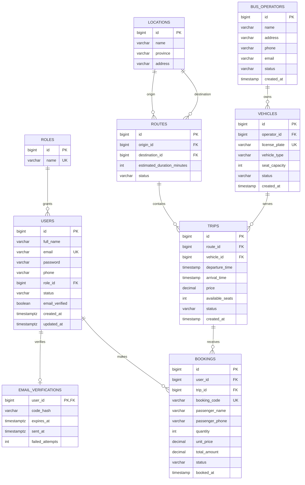

# 2. Thiết kế Database

## 2.1. Tổng quan

BusBooking sử dụng **PostgreSQL** để quản lý tài khoản, phân quyền, xác thực email, nhà xe, địa điểm, phương tiện, tuyến đường, chuyến xe và đặt vé. **Flyway** quản lý thay đổi schema thông qua các migration SQL trong source code.

Thiết kế tách các thực thể theo trách nhiệm để hạn chế trùng lặp dữ liệu; sử dụng khóa chính (PK), khóa ngoại (FK), ràng buộc duy nhất (UNIQUE) và các điều kiện kiểm tra (CHECK). Cấu trúc chính có **9 bảng**:

| Bảng | Vai trò |
|---|---|
| `roles` | Các vai trò hệ thống: `USER`, `ADMIN`, `SUPER_ADMIN` |
| `users` | Tài khoản, quyền và trạng thái xác minh email |
| `email_verifications` | Challenge OTP đang có hiệu lực; chỉ lưu mã băm/HMAC, không lưu OTP gốc |
| `bus_operators` | Thông tin nhà xe |
| `locations` | Địa điểm đi/đến |
| `vehicles` | Phương tiện thuộc nhà xe |
| `routes` | Tuyến đường giữa hai địa điểm |
| `trips` | Lịch khởi hành cụ thể của một tuyến |
| `bookings` | Đơn đặt vé của người dùng |

> **Nguồn chính xác của schema:** Các file Flyway migration trong `src/main/resources/db/migration/`, được cấu hình bằng `spring.flyway.locations`. Source hiện có 16 migration liên tục V1–V16; V16 bỏ bốn index tăng tốc của V14/V15 và giữ các ràng buộc toàn vẹn. Trạng thái database đang chạy chưa được truy vấn để xác minh.

## 2.2. Sơ đồ quan hệ (ERD)



Quan hệ `USERS` – `EMAIL_VERIFICATIONS` là **1 – 0..1**: mỗi người dùng có nhiều nhất một challenge OTP đang được lưu. Các quan hệ một–nhiều khác được thể hiện bằng khóa ngoại ở bảng phía nhiều.

## 2.3. Các bảng và trường chính

### 2.3.1. Tài khoản và xác thực

**`roles`**

| Trường | Kiểu | Ý nghĩa |
|---|---|---|
| `id` | BIGINT | PK |
| `name` | VARCHAR(30) | Vai trò duy nhất |

**`users`**

| Trường | Kiểu | Ý nghĩa |
|---|---|---|
| `id` | BIGINT | PK |
| `full_name` | VARCHAR(100) | Họ tên |
| `email` | VARCHAR(100) | Email đăng nhập, duy nhất |
| `password` | VARCHAR(255) | Hash mật khẩu |
| `phone` | VARCHAR(20) | Số điện thoại |
| `role_id` | BIGINT | FK → `roles.id` |
| `status` | VARCHAR(20) | Trạng thái tài khoản |
| `email_verified` | BOOLEAN | `NOT NULL DEFAULT FALSE`, độc lập với `status` |
| `created_at`, `updated_at` | TIMESTAMPTZ | Mốc thời gian tạo/cập nhật |

**`email_verifications`**

| Trường | Kiểu | Ý nghĩa |
|---|---|---|
| `user_id` | BIGINT | PK, FK → `users.id`, `ON DELETE CASCADE` |
| `code_hash` | VARCHAR(64) | HMAC-SHA256 digest, không lưu OTP thô |
| `expires_at` | TIMESTAMPTZ | Hạn OTP |
| `sent_at` | TIMESTAMPTZ | Thời gian gửi |
| `failed_attempts` | INT | Số lần xác thực sai |

Khi xác minh thành công, challenge được xóa và `users.email_verified` được chuyển thành `TRUE` trong cùng giao dịch. Khi gửi lại OTP, challenge được thay mới.

### 2.3.2. Nhà xe, địa điểm và phương tiện

**`bus_operators`**

| Trường | Kiểu | Ý nghĩa |
|---|---|---|
| `id` | BIGINT | PK |
| `name` | VARCHAR(150) | Tên nhà xe |
| `address` | VARCHAR(255) | Địa chỉ |
| `phone` | VARCHAR(20) | Điện thoại |
| `email` | VARCHAR(100) | Email liên hệ |
| `status` | VARCHAR(20) | Trạng thái |
| `created_at` | TIMESTAMP | Thời điểm tạo |

**`locations`**

| Trường | Kiểu | Ý nghĩa |
|---|---|---|
| `id` | BIGINT | PK |
| `name` | VARCHAR(100) | Tên địa điểm |
| `province` | VARCHAR(100) | Tỉnh/thành phố |
| `address` | VARCHAR(255) | Địa chỉ |

**`vehicles`**

| Trường | Kiểu | Ý nghĩa |
|---|---|---|
| `id` | BIGINT | PK |
| `operator_id` | BIGINT | FK → `bus_operators.id` |
| `license_plate` | VARCHAR(20) | Biển số duy nhất |
| `vehicle_type` | VARCHAR(50) | Loại phương tiện |
| `seat_capacity` | INT | Sức chứa |
| `status` | VARCHAR(20) | Trạng thái |
| `created_at` | TIMESTAMP | Thời điểm tạo |

### 2.3.3. Tuyến, chuyến và đặt vé

**`routes`**

| Trường | Kiểu | Ý nghĩa |
|---|---|---|
| `id` | BIGINT | PK |
| `origin_id` | BIGINT | FK → `locations.id` |
| `destination_id` | BIGINT | FK → `locations.id` |
| `estimated_duration_minutes` | INT | Thời gian di chuyển dự kiến |
| `status` | VARCHAR(20) | Trạng thái tuyến |

**`trips`**

| Trường | Kiểu | Ý nghĩa |
|---|---|---|
| `id` | BIGINT | PK |
| `route_id` | BIGINT | FK → `routes.id` |
| `vehicle_id` | BIGINT | FK → `vehicles.id` |
| `departure_time`, `arrival_time` | TIMESTAMP | Thời gian đi/đến |
| `price` | DECIMAL(12,2) | Giá vé hiện tại |
| `available_seats` | INT | Số ghế còn trống |
| `status` | VARCHAR(20) | Trạng thái chuyến |
| `created_at` | TIMESTAMP | Thời điểm tạo |

`routes` thể hiện hành trình; `trips` thể hiện **một chuyến khởi hành cụ thể** trên hành trình đó.

**`bookings`**

| Trường | Kiểu | Ý nghĩa |
|---|---|---|
| `id` | BIGINT | PK |
| `user_id` | BIGINT | FK → `users.id` |
| `trip_id` | BIGINT | FK → `trips.id` |
| `booking_code` | VARCHAR(30) | Mã đặt vé duy nhất |
| `passenger_name` | VARCHAR(100) | Tên hành khách |
| `passenger_phone` | VARCHAR(20) | Số điện thoại hành khách |
| `quantity` | INT | Số vé |
| `unit_price` | DECIMAL(12,2) | Đơn giá tại thời điểm đặt |
| `total_amount` | DECIMAL(22,2) | Tổng tiền tại thời điểm đặt, mở rộng ở V21 |
| `status` | VARCHAR(30) | Trạng thái đặt vé |
| `booked_at` | TIMESTAMP | Thời điểm đặt |

Giữ `unit_price` và `total_amount` trong booking để không làm thay đổi lịch sử thanh toán khi giá của chuyến thay đổi.

## 2.4. Ràng buộc toàn vẹn

| Nhóm | Quy tắc đáng chú ý |
|---|---|
| Khóa chính/ngoại | Liên kết đúng các bảng như ERD; `email_verifications.user_id` đồng thời là PK và FK |
| Duy nhất | `roles.name`, `users.email`, `vehicles.license_plate`, `bookings.booking_code` |
| Một SUPER_ADMIN | Theo tài liệu migration V11, `uk_users_single_super_admin` giới hạn tối đa một tài khoản thuộc vai trò này, kể cả tài khoản `INACTIVE` |
| Nhà xe (V13) | Tên/email được kiểm soát trùng sau chuẩn hóa |
| Địa điểm (V12) | Bộ ba `(name, province, address)` duy nhất theo so sánh không phân biệt hoa/thường |
| Tuyến (V14) | Cặp có hướng `(origin_id, destination_id)` không được trùng; tuyến ngược chiều là bản ghi khác |
| Phương tiện (V15) | Biển số chuẩn hóa thành uppercase, bỏ khoảng trắng và phải duy nhất |
| CHECK cơ bản | `seat_capacity > 0`, `price >= 0`, `available_seats >= 0`, `quantity > 0`, `unit_price >= 0`, `total_amount >= 0`, `origin_id <> destination_id` |

Các quy tắc vượt phạm vi CHECK/FK do **tầng nghiệp vụ và transaction** xử lý, gồm: không bán vượt số ghế trống; không đặt vé cho chuyến không hợp lệ; hoàn ghế khi hủy booking hợp lệ; giới hạn thời gian và số lần nhập sai OTP; chỉ chủ sở hữu hoặc người có thẩm quyền được thao tác với booking.

## 2.5. Index và tra cứu

Các khóa `PRIMARY KEY`/`UNIQUE` tạo hoặc dựa trên index tương ứng trong PostgreSQL. Nhóm truy vấn đáng quan tâm khi đánh giá hiệu năng gồm:

| Truy vấn | Trường truy vấn liên quan |
|---|---|
| Đăng nhập | `users.email` |
| Tra cứu challenge | `email_verifications.user_id` |
| Tìm tuyến | `routes.origin_id`, `routes.destination_id` |
| Tìm chuyến | `trips.route_id`, `trips.departure_time` |
| Lịch sử đặt vé | `bookings.user_id` |
| Danh sách booking của chuyến | `bookings.trip_id` |

V20 thêm hai partial index cho chuyến `SCHEDULED` còn ghế theo `(departure_time, id)` và `(route_id, departure_time, id)`. Index `bookings(user_id, booked_at DESC, id DESC)` hỗ trợ phân trang lịch sử cá nhân.

V22 thêm index `bookings(trip_id, status)` để quản trị tra cứu và đếm ghế xác nhận theo chuyến. Hai partial index theo giờ đi của chuyến `SCHEDULED` và giờ đến của chuyến `IN_PROGRESS` hỗ trợ job chuyển trạng thái, kể cả khi chuyến đã hết ghế.

## 2.6. Migration Phase 2

| Phiên bản | Thay đổi |
|---|---|
| V17 | `booking_idempotency` giữ hash yêu cầu và ID booking theo cặp `(user_id, request_key)`. Bản ghi hết hạn sau 24 giờ. |
| V18 | Exclusion constraint GiST với `btree_gist` chặn hai khoảng giờ chồng nhau trên cùng xe. Khoảng giờ gồm thời điểm đi và loại thời điểm đến. Chuyến `CANCELLED` không tham gia ràng buộc. |
| V19 | `verification_outbox` giữ nội dung OTP đã mã hóa, số lần gửi và thời điểm có thể thử lại. Worker xóa nội dung mã hóa khi hoàn tất hoặc hết hạn. |
| V20 | Thêm index tìm chuyến còn ghế và phân trang lịch sử. |
| V21 | Mở rộng `bookings.total_amount` thành `NUMERIC(22,2)`. |
| V22 | Thêm index booking theo chuyến và partial index tìm chuyến tới mốc chuyển trạng thái. |

Trước khi áp dụng V18 vào DB có dữ liệu cũ, kiểm tra lịch trùng bằng truy vấn dưới đây. Migration sẽ dừng với ID của một cặp chuyến xung đột nếu còn dữ liệu cần xử lý. Tài khoản migration cần quyền tạo extension `btree_gist` hoặc extension phải được quản trị DB cài trước.

```sql
SELECT a.vehicle_id, a.id AS first_trip, b.id AS second_trip
FROM trips a
JOIN trips b ON a.vehicle_id = b.vehicle_id AND a.id < b.id
WHERE a.status <> 'CANCELLED' AND b.status <> 'CANCELLED'
  AND a.departure_time < b.arrival_time
  AND b.departure_time < a.arrival_time;
```

Để đối soát ghế của chuyến sắp đi, kiểm tra `available_seats + SUM(quantity)` của các booking `CONFIRMED` bằng sức chứa hiện tại của xe.

```sql
SELECT t.id, t.available_seats,
       COALESCE(SUM(b.quantity), 0) AS confirmed_seats, v.seat_capacity
FROM trips t
JOIN vehicles v ON v.id = t.vehicle_id
LEFT JOIN bookings b ON b.trip_id = t.id AND b.status = 'CONFIRMED'
WHERE t.status = 'SCHEDULED'
  AND t.departure_time > CURRENT_TIMESTAMP AT TIME ZONE 'Asia/Ho_Chi_Minh'
GROUP BY t.id, v.seat_capacity
HAVING t.available_seats + COALESCE(SUM(b.quantity), 0) <> v.seat_capacity;
```

## 2.6. Migration và vận hành schema

Schema được quản lý bởi **Flyway** khi ứng dụng khởi động, với 16 file V1–V16 trong source. Các mốc thay đổi đáng chú ý đã đối chiếu migration là:

| Migration | Nội dung đối chiếu từ migration SQL |
|---|---|
| V9, V10 | V9 tạo `email_verifications`; V10 chỉ thêm `users.email_verified BOOLEAN NOT NULL DEFAULT FALSE` |
| V11 | Thêm vai trò `SUPER_ADMIN` và giới hạn tối đa một tài khoản giữ vai trò này |
| V12 | Chuẩn hóa và ràng buộc duy nhất dữ liệu địa điểm |
| V13 | Chuẩn hóa và kiểm soát trùng nhà xe |
| V14 | Ràng buộc duy nhất tuyến theo cặp điểm đi/đến có hướng |
| V15, V16 | V15 chuẩn hóa/kiểm soát biển số và thêm hai index tăng tốc; V16 bỏ bốn index tăng tốc của V14/V15, giữ toàn bộ ràng buộc toàn vẹn |

Không sửa nội dung migration đã áp dụng trên database đang sử dụng. Nếu cần thay đổi schema, tạo migration mới và kiểm tra tương thích với dữ liệu cũ.

