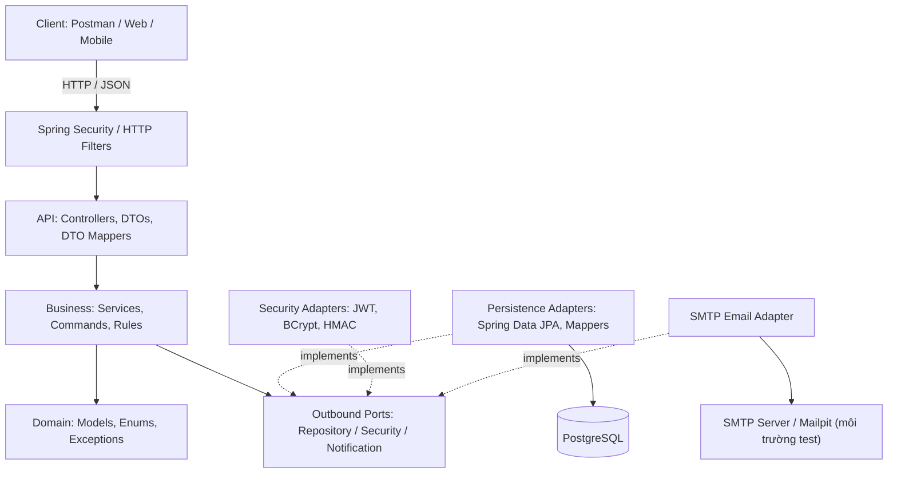
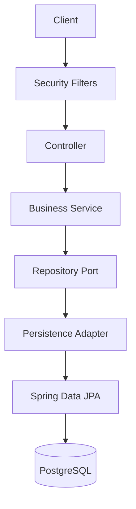
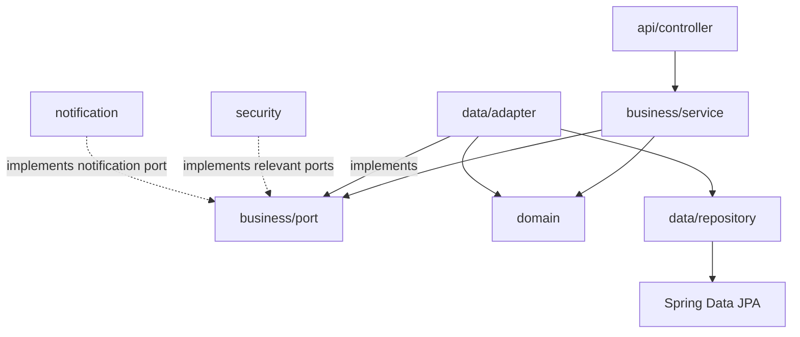
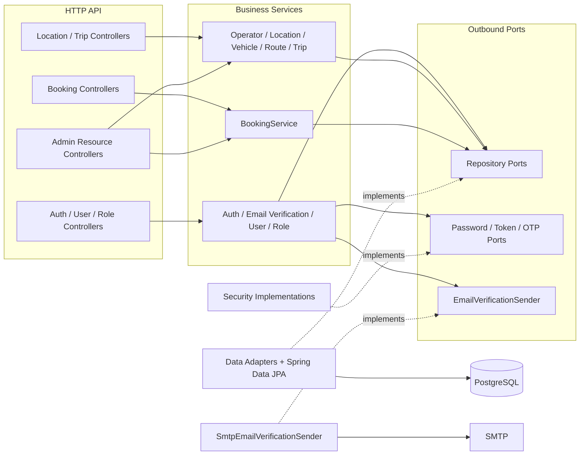
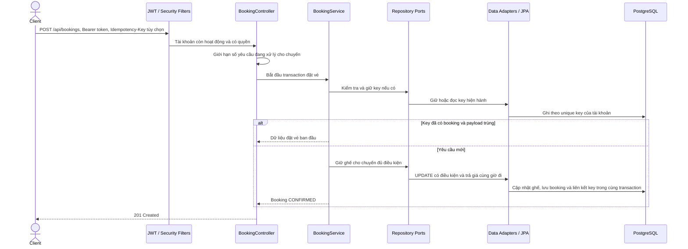
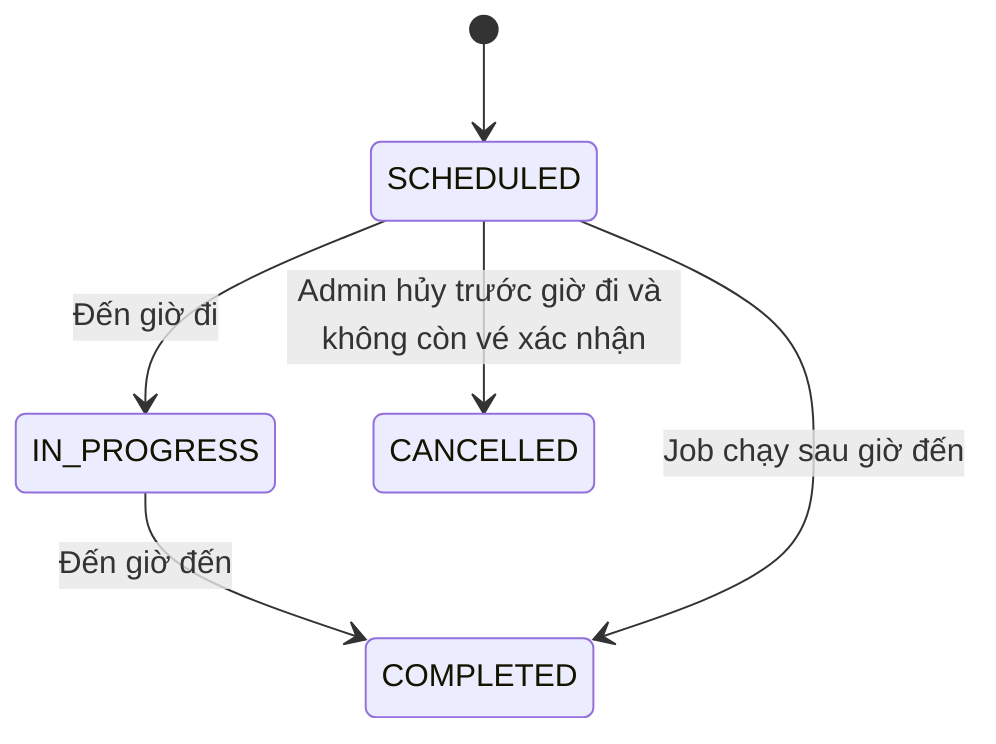
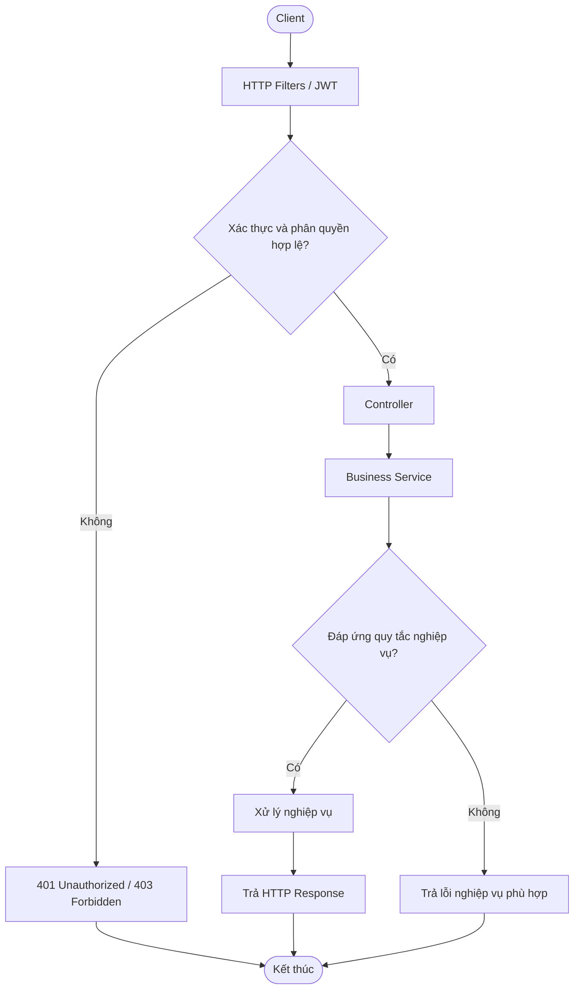
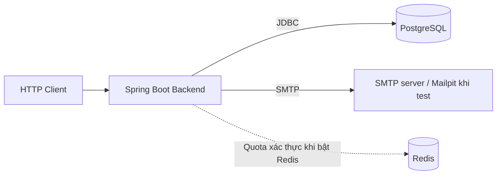

# 3. Kiến trúc hệ thống

## 3.1. Tổng quan

BusBooking là backend hỗ trợ quản lý tài khoản, xác thực email, danh mục nhà xe/địa điểm/phương tiện/tuyến đường, tìm kiếm chuyến xe và đặt vé. Ứng dụng được xây dựng bằng **Java 21, Spring Boot**, giao tiếp qua **REST/JSON**, lưu trữ trên **PostgreSQL** và quản lý thay đổi schema bằng **Flyway**.

Về tổ chức phần mềm, hệ thống kết hợp:

- **Kiến trúc phân lớp:** phân chia trách nhiệm thành các lớp tiếp nhận API, xử lý nghiệp vụ và truy cập dữ liệu.
- **Ports và Adapters:** nghiệp vụ khai báo các *port* (interface) để làm việc với repository, xác thực và gửi thông báo; các lớp hạ tầng cung cấp implementation tương ứng.

Đây là **một ứng dụng backend** được phân tách thành các package. Client có thể là Postman hoặc một giao diện web/mobile sử dụng API; tài liệu này không mặc định frontend đã được triển khai.

**Lưu ý:** Sơ đồ trên thể hiện cả luồng tương tác và quan hệ triển khai interface. Các mũi tên `implements` **không** có nghĩa Business phụ thuộc vào lớp adapter. Nhánh JPA được minh họa; `EmailVerificationRepositoryAdapter` và `RoleManagementRepositoryAdapter` còn dùng `JdbcTemplate` trực tiếp.

## 3.2. Các thành phần và trách nhiệm

| Thành phần | Package chính | Vai trò |
|---|---|---|
| API | `api/controller`, `api/dto`, `api/mapper`, `api/validation` | Nhận request, xác thực dữ liệu ở ranh giới HTTP, ánh xạ DTO và trả response |
| Business | `business/service`, `business/command`, `business/result` | Điều phối use case, kiểm tra quy tắc nghiệp vụ, tạo kết quả độc lập với định dạng HTTP |
| Outbound Ports | `business/port/repository`, `business/port/security`, `business/port/notification` | Định nghĩa các hợp đồng cần dùng từ hạ tầng |
| Domain | `domain/model`, `domain/enums`, `domain/exception` | Mô hình nghiệp vụ, trạng thái và ngoại lệ nghiệp vụ |
| Persistence | `data/adapter`, `data/repository`, `data/entity`, `data/mapper` | Hiện thực repository port bằng JPA/mapping domain ↔ entity; OTP và quản lý role còn dùng `JdbcTemplate` |
| Security | `security`, `security/ratelimit` | Xác thực JWT, mã hóa mật khẩu, HMAC OTP, giới hạn tần suất và xử lý lỗi truy cập |
| Notification | `notification` | Worker đọc outbox và adapter gửi email xác minh qua SMTP |
| Cross-cutting | `config`, `exception` | Cấu hình ứng dụng, OpenAPI, biểu diễn lỗi HTTP và xử lý exception tập trung |
| Persistence schema | `src/main/resources/db/migration` | Các migration Flyway V1–V22 cho PostgreSQL |

### API layer

Các controller hiện có được tổ chức theo nhóm nghiệp vụ:

- **Tài khoản/quyền:** `AuthController`, `UserController`, `RoleManagementController`.
- **Đọc dữ liệu công khai hoặc theo quyền:** `LocationController`, `TripController`, `BookingController`.
- **Quản trị:** `AdminBookingController`, `AdminLocationController`, `AdminOperatorController`, `AdminRouteController`, `AdminTripController`, `AdminVehicleController`.

Mỗi controller làm việc với DTO của `api/dto` và mapper của `api/mapper`. **Không có** một `AdminController` chung trong cây source hiện tại; chức năng quản trị được tách theo tài nguyên. Mô tả đường dẫn/HTTP method chi tiết thuộc `04-api-design.md` và file OpenAPI xuất từ ứng dụng.

### Business và Domain

Các service hiện diện trong `business/service` gồm `AuthService`, `EmailVerificationService`, `UserService`, `RoleManagementService`, `BootstrapSuperAdminService`, `OperatorService`, `LocationService`, `VehicleService`, `RouteService`, `TripService`, `BookingService`, cùng các chính sách đầu vào như `AuthInputPolicy` và `OperatorInputPolicy`.

- **Business service** thực hiện luồng use case, phối hợp các port và áp dụng điều kiện nghiệp vụ.
- **Domain model / enum** biểu diễn `User`, `Operator`, `Vehicle`, `Route`, `Trip`, `Booking` cùng các trạng thái liên quan.
- **Domain exception** biểu diễn các tình huống nghiệp vụ, ví dụ `InsufficientSeatsException`, `TripConflictException`, `ForbiddenOperationException`, `DuplicateRouteException`.

Những quy tắc như quyền sở hữu booking, số ghế khả dụng hoặc trạng thái chuyến không nên được viết lặp lại trong controller hay repository adapter.

## 3.3. Quy tắc phụ thuộc (Dependency Rule)

Cần phân biệt **luồng gọi lúc chạy** và **phụ thuộc khi biên dịch**:

**Luồng gọi khi xử lý HTTP:** Sơ đồ minh họa nhánh Spring Data JPA; adapter OTP/role có nhánh JDBC trực tiếp tới PostgreSQL.

**Phụ thuộc ở mã nguồn:**

Ví dụ có thể đối chiếu trong source:

| Vai trò | Class/interface |
|---|---|
| Repository port | `business/port/repository/BookingRepository.java` |
| Implementation | `data/adapter/BookingRepositoryAdapter.java` |
| Truy cập JPA | `data/repository/SpringDataBookingRepository.java` |
| Persistence entity | `data/entity/BookingEntity.java` |
| Mapping | `data/mapper/BookingPersistenceMapper.java` |

`BookingService` sử dụng hợp đồng repository của tầng nghiệp vụ thay vì cần biết trực tiếp cơ chế JPA hoặc PostgreSQL. Cách tách này giúp thay implementation lưu trữ và viết kiểm thử bằng fake/mock repository dễ hơn. Việc tất cả class đều tuân thủ quy tắc này cần được kiểm tra bằng import/dependency thực tế, không thể kết luận chỉ từ cấu trúc thư mục.

## 3.4. Các thành phần chức năng

Sơ đồ nhóm các controller/service để dễ nhìn, **không biểu diễn đầy đủ mọi lời gọi giữa từng class**. Ví dụ một Admin Controller có thể dùng service nghiệp vụ tương ứng; không có `AdminService` tổng hợp.

## 3.5. Luồng xử lý nghiệp vụ điển hình

### Đặt vé: `POST /api/bookings`

Các thay đổi ghế, booking và liên kết idempotency nằm trong một transaction. Tạo booking dùng `UPDATE … RETURNING` để giữ ghế và đọc giá. Service đối chiếu lại giờ đi sau khi câu lệnh lấy được khóa. Khi không giữ được ghế, service đọc hàng dưới khóa để phân biệt chuyến thiếu, chuyến hết ghế và chuyến không còn nhận đặt, hoặc thử giữ lại nếu ghế vừa được hoàn. Hủy booking khóa booking rồi khóa chuyến, sau đó kiểm tra sức chứa và hoàn ghế trong cùng transaction. Giới hạn đồng thời theo chuyến hoạt động trên từng instance, còn PostgreSQL vẫn quyết định số ghế có thể bán.

### Đăng ký và xác thực email

1. `AuthController` gọi `AuthService` và `EmailVerificationService`. Adapter của `VerificationQueue` lưu tài khoản và nội dung OTP đã mã hóa trong cùng transaction, rồi API trả `201`.
2. `VerificationOutboxWorker` nhận quyền xử lý một mục tới hạn qua `SKIP LOCKED` và lease, rồi gọi SMTP ngoài transaction.
3. Nếu gửi thành công, worker lưu HMAC digest của mã mới và xóa nội dung mã hóa khỏi outbox. Nếu gửi lỗi, worker đặt lịch gửi lại và giữ nguyên mã đã gửi trước đó. SMTP có thể nhận cùng email lần nữa khi tiến trình dừng sau khi gửi nhưng trước khi ghi nhận hoàn tất.
4. Người dùng xác minh OTP rồi đăng nhập để nhận JWT. Filter dùng projection ID, trạng thái và role hiện hành để xác thực các request sau đó.

### Vòng đời chuyến

Cây source có `BootstrapSuperAdminService` và `RoleManagementService`; chi tiết điều kiện tạo SUPER_ADMIN, nâng/hạ quyền và quy tắc xác minh email cần tham chiếu API/kiểm thử hiện hành, thay vì suy ra chỉ từ tên class.

## 3.6. Bảo mật và xử lý lỗi

### Authentication & Authorization

- `SecurityConfig` tổ chức các thành phần Spring Security và quy tắc truy cập HTTP.
- `JwtAuthenticationFilter`, `JwtService` và `CurrentUserLoader` tham gia xử lý request có Bearer token.
- `BCryptPasswordHasher`, `HmacVerificationCodeProvider` tương ứng với mật khẩu và mã OTP.
- `AuthRateLimitFilter` dùng địa chỉ client do Tomcat xác định. Compose cấu hình chỉ tin IP của Nginx, và Nginx ghi lại địa chỉ client từ kết nối. Bộ giới hạn local dùng bộ nhớ. Chế độ Redis dùng cùng quota theo IP và endpoint trên các instance.
- Role nghiệp vụ được biểu diễn bằng `RoleName`; code hiện có các thành phần quản lý role/SUPER_ADMIN. Quyền truy cập cụ thể phải lấy từ `SecurityConfig` và service tương ứng.

### Exception handling

- `domain/exception`: mô tả lỗi nghiệp vụ, không gắn trực tiếp với JSON HTTP.
- `exception/GlobalExceptionHandler`, `ErrorResponse`, `ApiErrorWriter`: hỗ trợ chuyển lỗi sang phản hồi API.
- `JsonAuthenticationEntryPoint`, `JsonAccessDeniedHandler` và `ApiExceptionBoundaryFilter`: xử lý một số trường hợp lỗi tại ranh giới Security/filter.

Việc ánh xạ lỗi sang HTTP 400/401/403/404/409 phải căn cứ vào handler thực tế và đặc tả OpenAPI; không nên cố định mã lỗi chỉ từ tên exception.

## 3.7. Kiến trúc dữ liệu và triển khai

### Database

Ứng dụng dùng PostgreSQL qua Spring Data JPA và JdbcTemplate. Các adapter dùng JDBC cho giữ ghế, idempotency, outbox, xác minh email và quản lý role. Flyway quản lý schema qua V1–V22.

Tài liệu thiết kế bảng, khóa ngoại, constraint và index: [`02-database-design.md`](02-database-design.md).

### Môi trường chạy

- **Chạy ứng dụng:** có thể thực thi Spring Boot trên máy hoặc trong container; chi tiết port, biến môi trường, health check và các service của Docker Compose phải lấy từ cấu hình triển khai thực tế.
- **Docker/Compose:** phục vụ đóng gói và khởi chạy môi trường phát triển/đánh giá. Không mặc định mọi thành phần ở sơ đồ đều có container riêng.
- **Kaggle CPU:** bài kiểm thử tải Pha 1 chạy Java, PostgreSQL và Locust trong notebook, **không phải sơ đồ triển khai Docker production**. Xem [`../load-tests/README.md`](../load-tests/README.md) để biết baseline.

